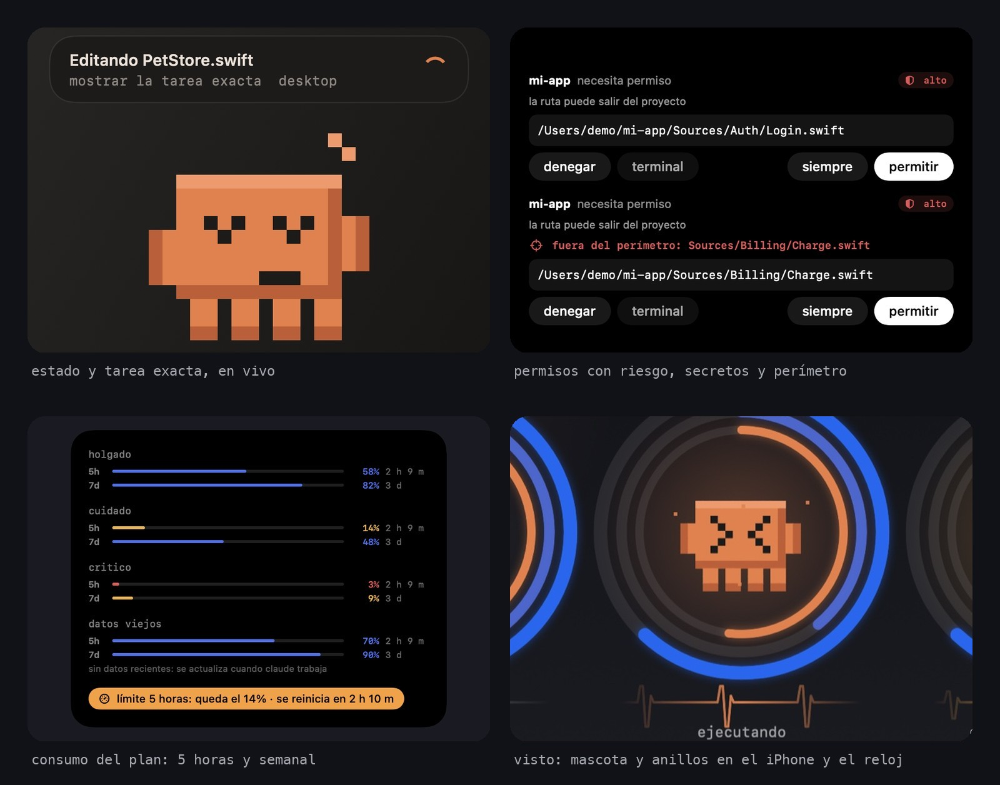
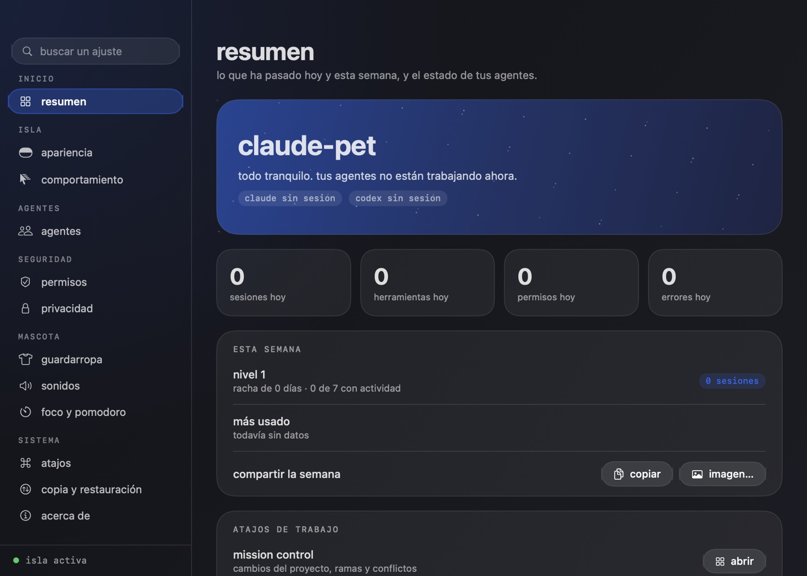
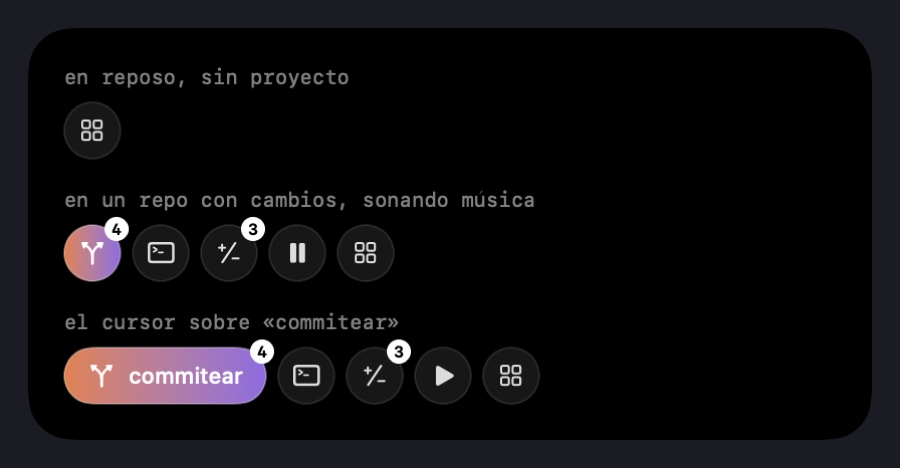
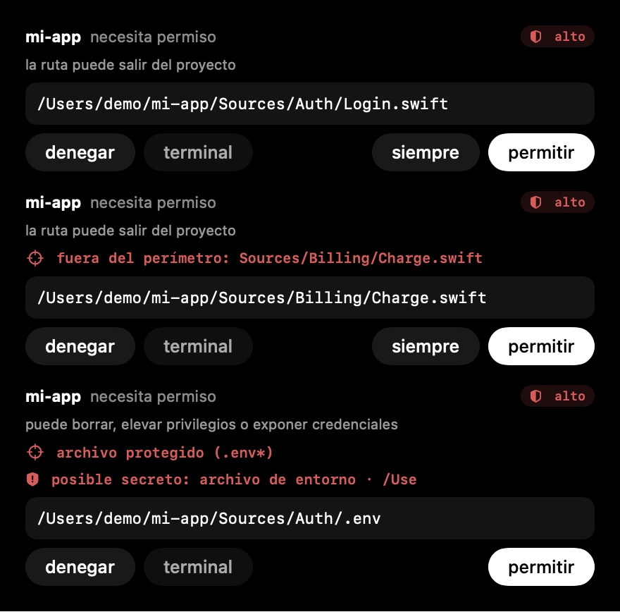
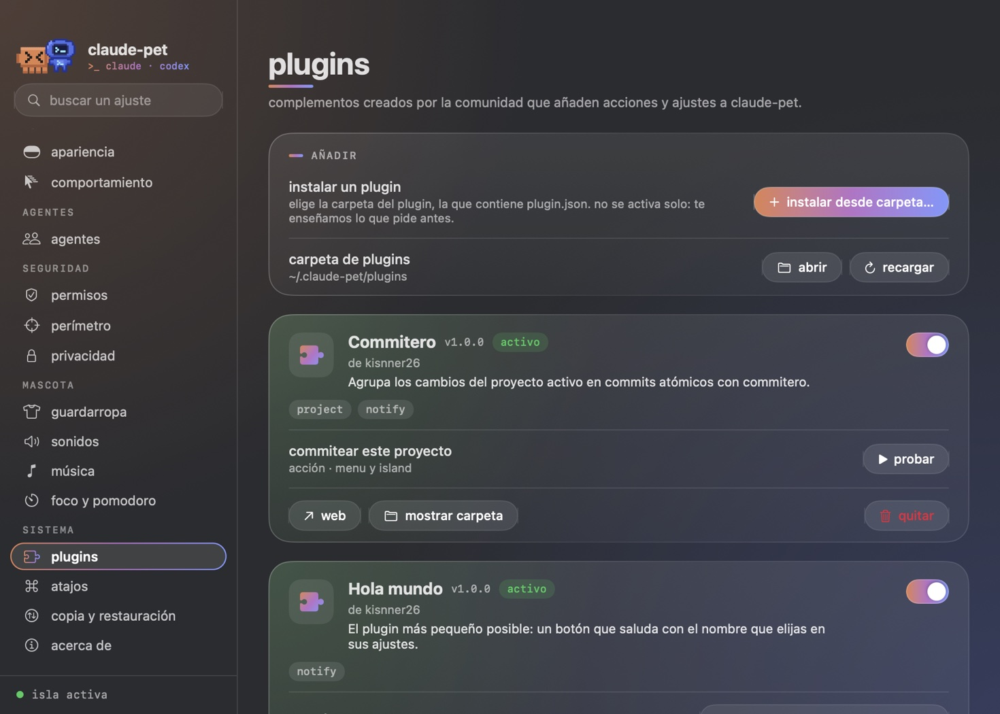

# claude pet

dos mascotas pixel-art para macos, una por herramienta: claude code y codex. muestran en tiempo real lo que hace cada agente, y pueden vivir como una isla anclada al notch desde donde respondes permisos y preguntas sin salir de lo que haces. swiftui puro, sin dependencias, todo local.

página: https://kisnner26.github.io/claude-pet/ · windows: [instalación](windows/README.md)


## qué hace

- **estado real**: inactivo, pensando, ejecutando, esperando tu aprobación, listo o error, con una burbuja que dice la tarea exacta («editando PetStore.swift»). la de claude sale si usas claude code y la de codex si usas codex.
- **isla en el notch**: se despliega solo cuando hace falta. permisos con `permitir`, `siempre` y `denegar`, preguntas con opciones, ticker de pasos, contexto restante y mission control. detalle en [docs/ISLAND.md](docs/ISLAND.md).
- **aprobar con criterio**: riesgo y secretos en cada permiso, reglas con caducidad, [perímetro](docs/PERIMETRO.md) por proyecto, puntos de restauración con git y registro de auditoría local.
- **consumo del plan**: barras del límite de 5 horas y semanal en la isla, con aviso al 80 y al 95 %.
- **visto**: app de iPhone y Apple Watch para aprobar permisos con un toque. [más abajo](#visto).
- **plugins y taller**: acciones, ajustes y eventos con una carpeta y un `plugin.json`, y un catálogo para instalar los de otros.
- **más**: reproductor de música con la mascota bailando al compás, guardarropa, acceso rápido que cambia según la app activa, traspaso entre claude y codex, modo foco y pomodoro.



## ajustes

menú de la barra → «ajustes…» (⌘,). quince páginas con buscador y vidrio real del sistema; el naranja de claude y el azul de codex tiñen la ventana.



| acceso rápido | perímetro | plugins |
|---|---|---|
|  |  |  |

## visto

carpeta [companion/](companion/README.md). claude pet escucha en tu red local y habla con la app por un canal cifrado (ChaCha20-Poly1305) cuya clave sale de un código que se muestra en Ajustes → permisos, o de un QR. sin servidores ni cuentas.

- permisos y preguntas de claude en el iPhone y el reloj; desde fuera solo se permite o deniega esta vez, y lo de riesgo alto solo se puede denegar.
- estado en vivo de claude y codex con su mascota, tres anillos (plan de 5 h, semanal y contexto) y avisos de terminado o fallo.
- isla dinámica con botones, face id opcional, botón de acción, siri, giroscopio, háptica y sonidos sintetizados; en el reloj, double tap para permitir y girar la muñeca para denegar.


los permisos llegan mientras la app está activa o iOS la despierta; sin notificaciones push, no hay más.

## instalación

requiere macos 13+, command line tools y `jq`.

```sh
./build.sh                     # compila build/ClaudePet.app
open build/ClaudePet.app
./install-hooks.sh --dry-run   # muestra el diff exacto de ~/.claude/settings.json
./install-hooks.sh             # lo aplica tras pedir confirmación, con copia de respaldo
```

para la isla, activa `isla en el notch` en el menú. para responder permisos ahí, `permisos desde la isla`. el instalador añade también el statusline del plan sin tocar el que ya tengas. abre una sesión nueva de claude code para que cargue los hooks. si macos bloquea la app (firma ad-hoc): clic derecho, abrir.

desinstalar: `./install-hooks.sh --uninstall`, `pkill -x ClaudePet` y `rm -rf build ~/.claude-pet`.

## privacidad

- todo es local: sockets unix del mismo usuario (carpeta 0700, socket 0600). no hay telemetría ni credenciales.
- el detalle de la burbuja nunca sale por el pet bus: solo viaja el nombre del proyecto, y solo si lo activas.
- los hooks de la isla fallan abiertos: ante cualquier error o plazo agotado, claude code pregunta en la terminal como siempre.
- el traspaso es la única función que envía contenido a un tercero (el diff, al agente que elijas), y solo tras confirmarlo en un diálogo.
- visto solo habla con tu Mac por la red local y con tu código.

detalle completo en [docs/FUNCIONES.md](docs/FUNCIONES.md).

## documentación

| | |
|---|---|
| [todas las funciones](docs/FUNCIONES.md) | mascotas, mission control, ocho sistemas visuales, traspaso, pet bus |
| [isla](docs/ISLAND.md) · [ajustes](docs/AJUSTES.md) | protocolo, límites y páginas de ajustes |
| [perímetro](docs/PERIMETRO.md) · [música](docs/MUSICA.md) | permisos por carpeta y reproductor |
| [plugins](docs/PLUGINS.md) · [taller](workshop/README.md) | crear, instalar y publicar plugins |
| [visto](companion/README.md) | app de iPhone y Apple Watch |
| [cambios](CHANGELOG.md) · [releases](https://github.com/kisnner26/claude-pet/releases) | historial de versiones |

## pruebas

```sh
tests/permission.sh   # permisos de la isla de punta a punta con el hook real
tests/plugins.sh      # plugins y ejemplos
tests/workshop.sh     # catálogo del taller y paquetes manipulados
tests/plan.sh         # consumo del plan
tests/remote.sh       # visto: política, canal y respuestas
tests/cpu.sh          # cpu medio en reposo durante 30 s (falla sobre 5 %)
```

las imágenes de este readme son renders con el propio código de dibujo de la app, no capturas de pantalla.

## inspiración y licencia

la idea de una mascota flotante conectada a claude code viene de [ClaudeHub](https://github.com/NormanSMA/ClaudeHub) de NormanSMA. claude pet no usa su código. licencia [MIT](LICENSE).
