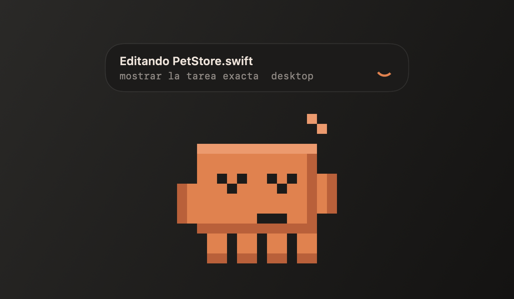
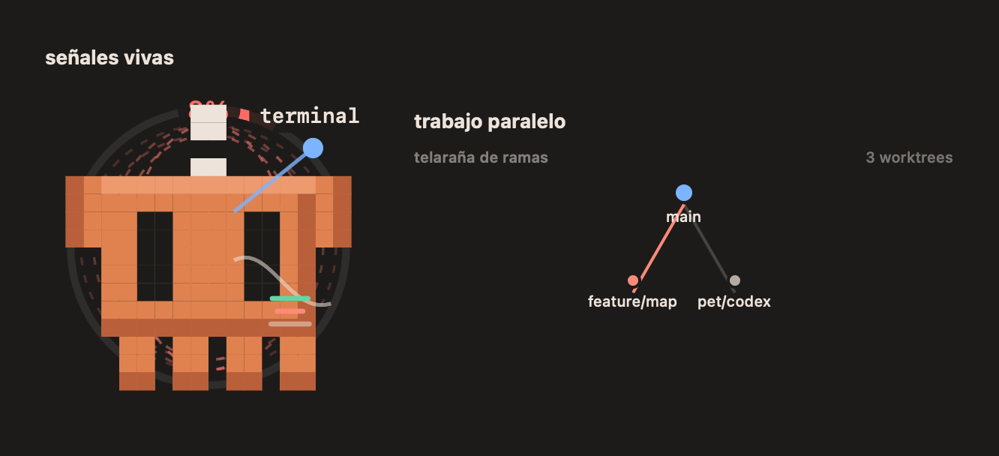
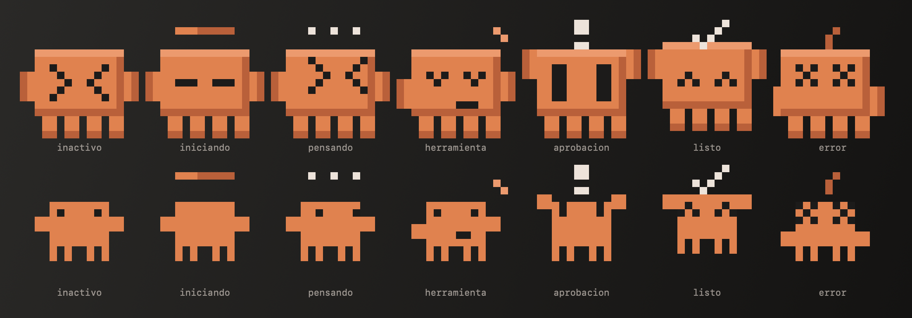
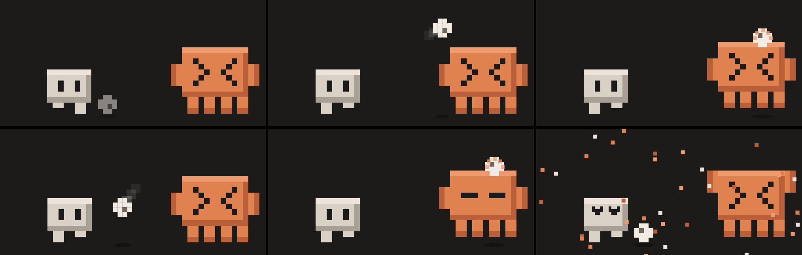
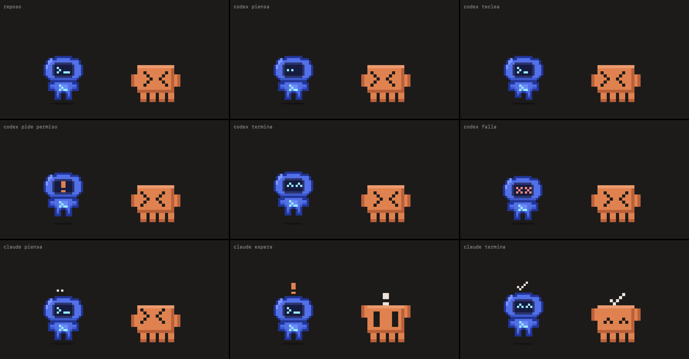

# claude pet

windows: [instalación y detalles](windows/README.md). tiene la burbuja con la tarea, mission control, avisos de cambio y atasco, diff y el traspaso entre claude y codex. todavía no tiene el fútbol, el abrazo ni el panel de aspectos de codex, que son solo de macos.

dos mascotas pixel-art para macos, una por herramienta: claude code y codex. cada una es una ventana independiente que aparece cuando usas su herramienta y muestra en tiempo real lo que hace. swiftui puro, sin dependencias, todo local. tambien puede vivir como una isla anclada al notch, con permisos y preguntas respondibles sin salir de lo que haces.

pagina: https://kisnner26.github.io/claude-pet/



## que hace

- una mascota por herramienta: la de claude aparece si usas claude code (la app abierta o una sesion con hooks) y la de codex si usas codex (la app abierta o su adaptador en el pet bus). si usas una, sale una; si usas las dos, salen las dos. se desactiva desde el menu.
- son entidades separadas: cada una se arrastra por su cuenta, recuerda su posicion y su clic abre su app.
- el visor de codex muestra su estado real: reposo, pensando (puntos), herramienta (teclea), permiso (`!` naranja), listo (`^ ^`) y error (`x x`). al arrastrarlo alterna los pies; reaccionan entre si, se saludan, se aplauden y juegan al futbol aunque esten en lados distintos de la pantalla.
- codex tiene su propio panel: tres aspectos, gestos automáticos y acciones manuales (saludar, saludo formal, celebrar, curiosidad y patrullar). cuando claude no está en uso, el panel pasa a modo solo; cuando ambos trabajan cerca, activa modo dúo con paquetes visuales entre las ventanas.
- refleja el estado real de claude code: inactivo, iniciando, pensando, ejecutando herramienta, esperando tu aprobacion, listo y error.
- la burbuja de actividad sirve a las dos: cada una muestra estado y tarea desde su sesión local. el pet bus sigue llevando únicamente presencia; la tarea de codex se lee en esta mac y nunca se publica.
- una burbuja sobre la mascota dice la tarea exacta: "editando PetStore.swift", la descripcion del comando que corre, la tarea en curso.
- dos aspectos (bloque y clasico). el icono de la barra de menu cambia segun lo que usas: la silueta de claude, la de codex o las dos juntas.
- abrazo automatico: si las dos mascotas estan juntas (menos de 56 px entre ventanas), a la misma altura y ambas tranquilas (en reposo o recien terminadas), se abrazan: comparten suelo y cada una rodea con un brazo el cuerpo de la otra. se corta si una trabaja, pide permiso o falla, para no esconder su estado, y respeta "reducir movimiento".
- clic abre la app de claude. se arrastra por toda la pantalla.
- aviso de contexto: si el proyecto cambia mientras claude piensa, la burbuja avisa para que revises el diff. opcional (apagado por defecto): bloquear la siguiente herramienta hasta tu proximo mensaje.
- detector de atasco: avisa si claude o codex llevan 5 min pensando o 15 min en una herramienta sin ninguna actividad.
- cuando codex termina en un proyecto donde claude sigue trabajando, el menu ofrece abrir el diff.
- un aro alrededor de claude estima cuánto contexto queda antes de la compactación: azul con margen, ámbar al acercarse y rojo en zona crítica. al pulsarlo abre el relevo de sesión.
- hasta doce bloques rodean la mascota con los archivos que están cambiando. su tamaño refleja líneas tocadas; azul es modificado, verde staged, crema nuevo y coral conflicto. al pulsar abre el diff o el archivo nuevo.

## isla en el notch

alternativa a las mascotas flotantes: un menu `modo` elige entre flotante e isla. en la isla las mascotas salen del notch (o de una barra superior en pantallas sin notch) y se despliegan solo cuando hace falta. detalle tecnico, protocolo y limites en [docs/ISLAND.md](docs/ISLAND.md); historial de funciones en [docs/CHANGELOG-ISLAND.md](docs/CHANGELOG-ISLAND.md).

- **cuatro modos**: oculta, asoma al pasar el cursor sobre el notch, compacta mientras hay tareas y abierta. se pliega sola a los 60 s con una cuenta atras en los ultimos 10, y se oculta si estas ausente 3 min.
- **permisos desde la isla**: un hook bloqueante muestra la herramienta y el detalle con `permitir`, `siempre` y `denegar`. es opt-in (`responder permisos desde la isla`). si algo falla, el hook sale vacio y claude code pregunta en la terminal como siempre.
- **preguntas**: las preguntas de claude code se responden en la isla, con opciones, seleccion multiple, varias preguntas seguidas y respuesta libre. cada permiso o pregunta se puede copiar o devolver a la terminal.
- **la mascota esta viva**: respira, parpadea, los ojos siguen el cursor, reacciona al toque (tres toques seguidos la marean) y salta al terminar una tarea. con "reducir movimiento" solo queda la mirada.
- **panel abierto**: pestanas por agente, ticker de pasos recientes con antiguedad y filtro, anillo y barra de contexto con tendencia y presion, rama y salud git, decisiones pendientes y acceso a mission control y al relevo de sesion.
- **atajos globales**: opt-in, solo ctrl+opcion+a/d/i/s/p, y se desregistran al cerrar. piden permiso de accesibilidad.
- **varias pantallas**: sigue al raton entre monitores; el tamano sale del notch real.


los permisos y preguntas viajan por `~/.claude-pet/ask.sock` (unix, 0600, mismo usuario). las lineas tienen tope de 4096 bytes, hay maximo ocho pendientes por tipo y el instalador de hooks es idempotente.

estado de verificacion: la logica, los protocolos y la limpieza al cerrar tienen autopruebas; en reposo la isla gasta cerca de 4 % de cpu. aun no esta probada sobre el notch fisico, el clic traversante, voiceover ni una sesion real de claude code y codex: la checklist manual esta en [docs/ISLAND.md](docs/ISLAND.md).

## ocho sistemas visuales

en macos, ambas mascotas convierten señales reales de su propio proyecto y sesión en ocho capas compactas. nunca reutilizan los datos de la otra para aparentar paridad:

1. **medidor de contexto**: aro azul, ámbar o rojo según los tokens que quedan antes del umbral de compactación; clic abre el relevo.
2. **mapa vivo de archivos**: bloques por archivo, tamaño por líneas tocadas y estado por color.
3. **patas de evidencia**: web scout nativo conecta la mascota con el texto seleccionado en cualquier navegador mediante accesibilidad de macos.
4. **cazador visual**: el mismo lector marca controles sin nombre, imágenes sin descripción y objetivos interactivos diminutos.
5. **telaraña de ramas**: mission control dibuja los worktrees reales; línea gruesa significa cambios, coral significa conflicto y línea discontinua significa worktree bloqueado.
6. **diff físico**: el primer clic sobre un archivo hace que la mascota tire de líneas reales del diff; el segundo abre el diff completo.
7. **capullo de contexto**: al entrar en presión ámbar o roja, varios hilos rodean la mascota y el aro permite preparar el relevo existente.
8. **radar entre aplicaciones**: una antena indica si una aprobación o error espera en claude o en la terminal; clic lleva a la aplicación correspondiente.



`web scout` funciona de forma nativa con safari, chrome, edge, arc, firefox y cualquier navegador que exponga el árbol de accesibilidad de macos. autoriza claude pet una vez en privacidad y seguridad, abre `web scout nativo` en el menú y usa `marcar selección` o `auditar controles visibles`. las marcas siguen al contenido al desplazarte y el menú permite recorrer los hallazgos. no instala extensiones y no guarda el contenido de la página.

`claudwler` (`iniciar claudwler` en el mismo menú) recorre los enlaces visibles y los marca en verde, ámbar o rojo mientras baja la página. al terminar abre un informe visual en html y copia un informe en markdown para pegar en claude code. si la página es `localhost:puerto`, localiza cada problema en el código del proyecto (`archivo:línea`). guarda un resumen de cada recorrido en `~/Library/Application Support/ClaudePet/claudwler/` para mostrar qué cambió desde la última vez. `verificar enlaces rotos en red` está apagado por defecto: al activarlo contacta los destinos con peticiones sin cookies.

## mission control

cinco funciones locales convierten la mascota en un tablero operativo:

- radar de colision: marca una posible colision cuando ambos llevan 10 s pensando o usando herramientas en un proyecto compartido. compara solo el nombre de la carpeta, ignora nombres genericos y tarda 5 s en apagarse; no pretende detectar ramas ni worktrees distintos con el mismo nombre.
- pulso git: muestra archivos afectados, staged, nuevos y conflictos sin leer su contenido. escanea al cambiar de proyecto, terminar, fallar, quedar inactivo o cada 15 s mientras trabaja; nunca ejecuta mas de un `git status` y conserva como maximo una solicitud pendiente.
- linea de tiempo: conserva en memoria los ultimos 16 cambios de estado de ambos agentes, con su hora.
- presupuesto de atencion: mide duracion, cantidad de herramientas usadas y las tres mas frecuentes. el ultimo resumen permanece visible al terminar.
- capsula de recuperacion: si el estado agregado permanece en error al menos 3 s, conserva la salud git del proyecto que fallo y ofrece abrir su diff. claude pet no distingue por si solo un `StopFailure` de otros errores agregados.

el pulso git usa `--no-optional-locks`, no permite prompts y corta cada proceso a los 10 s. limita la salida a 4 mb; ante ese limite o mas de 20 000 registros repite el estado sin archivos no rastreados y lo indica en el menu.

ninguno de estos datos cruza el pet bus ni se persiste entre ejecuciones.



## traspaso entre claude y codex

la mascota reúne los flujos de ambos agentes en el menú `traspaso claude y codex`. las revisiones y los relevos se inician a pedido tuyo.

- **segunda opinion**: `pedir a codex que revise lo de claude` (y al reves). arma el diff sin commitear del proyecto, lista los archivos nuevos sin seguimiento y lo manda al otro agente en modo solo lectura: `codex exec --sandbox read-only` o `claude -p` con solo `Read`, `Grep` y `Glob`. el resultado queda en `~/.claude-pet/review/` (0600) y se abre solo. se puede cancelar y tiene tope de 10 minutos.
- **confirmacion antes de enviar**: antes de lanzar, un dialogo te dice que proyecto, cuantos KB y a que proveedor se manda el diff. si cancelas, no sale nada. el diff viaja por stdin, nunca por argumentos.
- **relevo de sesión**: abre `continuar en otro agente…`, elige la dirección y un chat local de codex o claude code. la app detecta la carpeta del proyecto y extrae los mensajes visibles del usuario y del asistente (no lee razonamiento ni salidas de herramientas). si la carpeta detectada no es la del código, puedes cambiarla. revisa el contexto y pulsa `guardar, copiar y abrir` para pegarlo en el otro agente. si no aparece el chat, usa el modo manual. añade rama, commit, archivos modificados y commits recientes; el archivo se guarda en `~/.claude-pet/handoff/` (`0700`, archivos `0600`) y vence a las 24 h. no reabre la sesión nativa en el otro proveedor: transfiere un extracto revisable del diálogo.
- **colision resuelta**: cuando el radar marca que los dos trabajan en el mismo proyecto, el menu ofrece `pausar a claude hasta mi proximo mensaje` (el hook deniega su siguiente herramienta; tu siguiente mensaje lo levanta) y `worktree aislado` para claude o codex (una carpeta hermana `proyecto-pet-<agente>` en una rama nueva `pet/...`; no borra ni mueve nada y deja la ruta en el portapapeles).
- las revisiones lanzadas por la mascota no cuentan como una sesion tuya: el hook las ignora (`CLAUDE_PET_REVIEW=1`).
- necesita tener instalado el CLI del agente que revisa; el menu lo deshabilita si no lo encuentra.

## pet bus y futbol

las mascotas se descubren entre si por sockets unix locales (`~/.claude-pet/bus/`, protocolo json v1). cada mascota es una ventana propia. si se ven las dos, estan a menos de 640 px y llevan unos segundos inactivas, juegan un partido breve: una capa transparente une a las dos y la pelota viaja de la ventana de codex a la de claude, sin mover ninguna. si ambas trabajan, la misma capa cambia a modo dúo y muestra paquetes azul/terracota, sin enviar datos nuevos. se cancela al instante si alguna trabaja, respeta "reducir movimiento" y se puede disparar a mano.





protocolo y guia para el adaptador de codex en [docs/PET-BUS.md](docs/PET-BUS.md).

## como funciona

```
claude code --hook--> hooks/pet-hook.sh --socket unix 0600--> ClaudePet.app
claude code --PermissionRequest / preguntas--> hooks/pet-permission.sh, pet-question.sh --ask.sock--> isla
```

el script traduce 10 eventos de hook a un estado y lo manda por un socket local. los hooks de permisos y preguntas esperan tu respuesta en la isla y fallan abiertos. no hay red, ni credenciales, ni telemetria.

## privacidad

- solo sockets unix del mismo usuario (carpeta 0700, socket 0600).
- el detalle de la burbuja es local y nunca sale por el pet bus: descripcion del comando, nombre del archivo (no la ruta), programa de un comando (nunca sus argumentos), host de una url y tu ultimo mensaje.
- se apaga desde el menu. el nombre del proyecto no se comparte con otras mascotas salvo que lo actives.
- el detector de contexto solo calcula una huella local de nombres, fechas y tamanos de archivos; no lee contenido. ignora `.git`, dependencias, builds y logs.
- la ruta del proyecto llega a la app por el socket local (para la huella y el diff). no se muestra, no se escribe a disco y no cruza el pet bus: ahi solo va el nombre de la carpeta, y solo si lo activas.
- mission control mantiene rutas, rama, contadores, linea de tiempo y capsulas solo en memoria. ninguno se serializa en el pet bus.
- cada medidor de contexto lee únicamente los contadores de tokens de su transcript local activo. no conserva el contenido; claude permite ajustar el umbral con `CLAUDE_PET_COMPACTION_TOKENS` y codex usa la ventana registrada por su propia sesión.
- los hooks de la isla solo bloquean mientras esperan tu respuesta y con la opcion activada; ante cualquier error, plazo agotado o app cerrada devuelven salida vacia. validan la entrada, acotan su tamano y escapan la salida json; nunca ejecutan shell con rutas, nombres o detalles recibidos.
- el hook no bloquea nada salvo que actives "bloquear herramientas si el proyecto cambia" o pidas "pausar a claude" ante una colision. la marca caduca a los 10 min y se borra con tu siguiente mensaje o al cerrar la sesion.
- el traspaso es la unica funcion que envia contenido a un tercero (el diff, al proveedor del agente que elijas), y solo despues de que lo confirmes en un dialogo.
- web scout consulta bajo demanda el árbol de accesibilidad de la aplicación al frente. no captura pantalla ni accede al historial del navegador. claudwler solo usa red si activas `verificar enlaces rotos en red`, y guarda textos y destinos de enlaces de cada recorrido en tu carpeta de soporte.
- las cápsulas de relevo permanecen en esta mac hasta que vencen. crear una cápsula no la manda a ningún proveedor; solo se transmite cuando confirmas y pegas el contexto en el agente destino.

## instalacion

requiere macos 13+, command line tools y `jq`.

```sh
./build.sh                     # compila build/ClaudePet.app (firma ad-hoc)
open build/ClaudePet.app
./install-hooks.sh --dry-run   # muestra el diff exacto de ~/.claude/settings.json
./install-hooks.sh             # lo aplica tras pedir confirmacion, con copia de respaldo
```

para la isla: activa `isla en el notch` en el menu (o arranca con `-layout island`) y, si quieres responder permisos y preguntas ahi, `responder permisos desde la isla`. el instalador anade tambien los hooks de permisos y preguntas sin duplicar los que ya tengas.

abre una sesion nueva de claude code para que cargue los hooks. no pide permisos del sistema: escribe solo en `~/.claude-pet/` y, al instalar, fusiona sus hooks en `~/.claude/settings.json` sin tocar los tuyos. si macos bloquea la app (firma ad-hoc): clic derecho, abrir.

## pruebas

```sh
tests/manual.sh              # recorre cada estado
tests/bridge-capture.sh      # comprueba que el hook no filtra contenido
tests/hook-guard.sh          # el hook no bloquea por defecto; bloqueo opt-in, caducidad, clasificacion de pruebas
build/ClaudePet.app/Contents/MacOS/ClaudePet --selftest-safety   # huella, monitor, diff grande, parseo
build/ClaudePet.app/Contents/MacOS/ClaudePet --selftest-mission  # radar, git, timeline, presupuesto, recuperacion
build/ClaudePet.app/Contents/MacOS/ClaudePet --selftest-handoff  # comandos de solo lectura, prompt, revision con agentes simulados, worktree
build/ClaudePet.app/Contents/MacOS/ClaudePet --selftest-relay    # cápsulas portables, prompt y permisos locales
build/ClaudePet.app/Contents/MacOS/ClaudePet --selftest-scout    # reglas del auditor nativo de accesibilidad
build/ClaudePet.app/Contents/MacOS/ClaudePet --selftest-claudwler  # verificador, diff e informe de claudwler (usa red)
build/ClaudePet.app/Contents/MacOS/ClaudePet --snapshot-systems docs/img/sistemas-visuales.png
tests/bus.sh                 # pet bus con un codex simulado
tests/football.sh            # reglas del partido y escenarios visuales
tests/permission.sh          # permisos de la isla de punta a punta con el hook real
tests/cpu.sh                 # cpu medio en reposo durante 30 s (falla sobre 5 %)
swift build && .build/debug/ClaudePet --selftest-island      # maquina de estados, geometria, animacion
.build/debug/ClaudePet --selftest-question   # preguntas de la isla
.build/debug/ClaudePet --selftest-cleanup    # socket y bandera se borran al cerrar
build/ClaudePet.app/Contents/MacOS/ClaudePet --trigger football   # greet | cheer | concern
```

las imagenes de este readme se generan con el propio codigo de dibujo de la app (`ClaudePet --snapshot-hero docs/img`); no son capturas de pantalla.

## desinstalar

```sh
./install-hooks.sh --uninstall   # quita solo estos hooks
pkill -x ClaudePet
rm -rf build ~/.claude-pet
```

## inspiracion

la idea de una mascota flotante conectada a claude code viene de [ClaudeHub](https://github.com/NormanSMA/ClaudeHub) de NormanSMA, un monitor local de tokens con una mascota llamada chispa. claude pet no usa su codigo: es otro proyecto, en swift, centrado en el estado y la tarea en curso.

## licencia

[MIT](LICENSE)
