# ajustes

Ventana propia de claude-pet, en el mismo estilo oscuro de cristal que la isla. Se abre desde el menú de la barra ("ajustes…", ⌘,) o con `ClaudePet --open-settings <página>` (`resumen`, `apariencia`, `comportamiento`, `agentes`, `permisos`, `perimetro`, `privacidad`, `guardarropa`, `sonidos`, `musica`, `foco`, `atajos`, `copia`, `acerca`).

La barra lateral agrupa las páginas en inicio, isla, agentes, seguridad, mascota y sistema. Junto a cada grupo va un contador de funciones encendidas (`2/3`), cada página que gobierna una función lleva un punto (verde encendida, hueco apagada), las que tienen opciones experimentales llevan la marca `exp`, y el pie suma las activas.

El buscador filtra por título y por palabras clave sin distinguir acentos: escribir "restauracion" lleva a copia y restauración. El botón de filtros (con el número de filtros activos) abre fichas: categoría (todo, isla, agentes, seguridad, mascota, sistema, cada una con cuántas páginas quedan) y «solo activados» y «solo experimentales», que se combinan con el texto. Los filtros no se guardan: al reabrir la ventana empieza limpia.

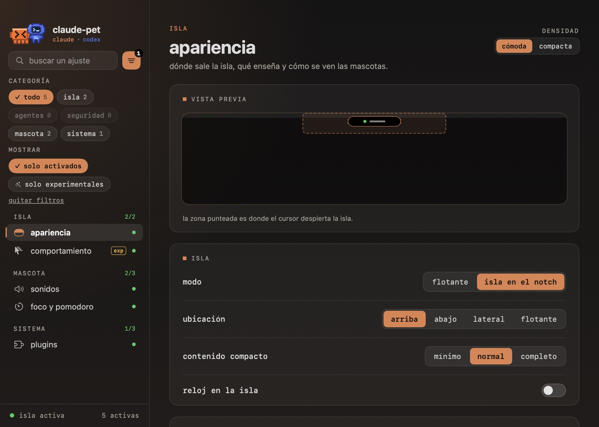

## páginas

| página | qué controla |
|---|---|
| resumen | tablero: una tarjeta por agente con su mascota y su estado, lo de hoy, la racha con sus siete días, la semana en barras (con el cambio frente a la anterior), el uso del plan (5 h y 7 d) y el contexto de cada agente; copiar o guardar como imagen; acceso a mission control y relevo |
| apariencia | modo, ubicación, contenido compacto, reloj, pantalla, mascotas, animaciones, partido, burbuja y avisos visuales, con vista previa |
| comportamiento | **abrir al iniciar sesión**, ancho y retraso de la zona de activación, cuánto tarda en plegarse, **acceso rápido de la isla** (qué acciones y en qué orden), aparición automática y fijar mascotas |
| agentes | una tarjeta por agente con su estado, mostrar u ocultar, aspecto con previsualización, gestos, detalle local y aviso de bloqueo |
| permisos | responder desde la isla, bloqueo si el proyecto cambia, puntos de restauración y reglas de aprobación (revocar una o todas) |
| perímetro | por dónde puede moverse el agente en cada proyecto: carpetas permitidas, archivos protegidos y avisar o bloquear. ver [PERIMETRO.md](PERIMETRO.md) |
| privacidad | nombre del proyecto al compartir, carpeta de datos, registro de decisiones y borrado de estadísticas |
| guardarropa | vista previa de las dos mascotas, atuendos por nivel con su aspecto en Claude y Codex, y atuendos de temporada |
| sonidos | volumen general y por categoría, prueba de cada sonido y sonidos propios |
| música | reproductor de Spotify y Apple Music en la isla y reacciones de la mascota. ver [MUSICA.md](MUSICA.md) |
| foco y pomodoro | foco manual o por horario y control del pomodoro |
| atajos | letra de cada atajo global, con control de duplicados |
| plugins | instalar, activar con permisos aprobados, ajustes y acciones de cada plugin. ver [PLUGINS.md](PLUGINS.md) |
| copia y restauración | exportar, importar y restablecer ajustes |
| acerca de | versión, **copiar diagnóstico**, commitero y dónde vive cada dato |

## identidad

Claude y Codex comparten la rejilla pixel-art y el glifo `>_`; el color los separa. La ventana usa vidrio real del sistema y un solo acento, el naranja `#E0824F` de Claude; el azul `#5270E8` de Codex aparece solo donde se habla de Codex. Rótulos y cifras en mono, tarjetas sin degradados y sin cajas anidadas. Las dos mascotas van en la barra lateral, vestidas como las tengas.

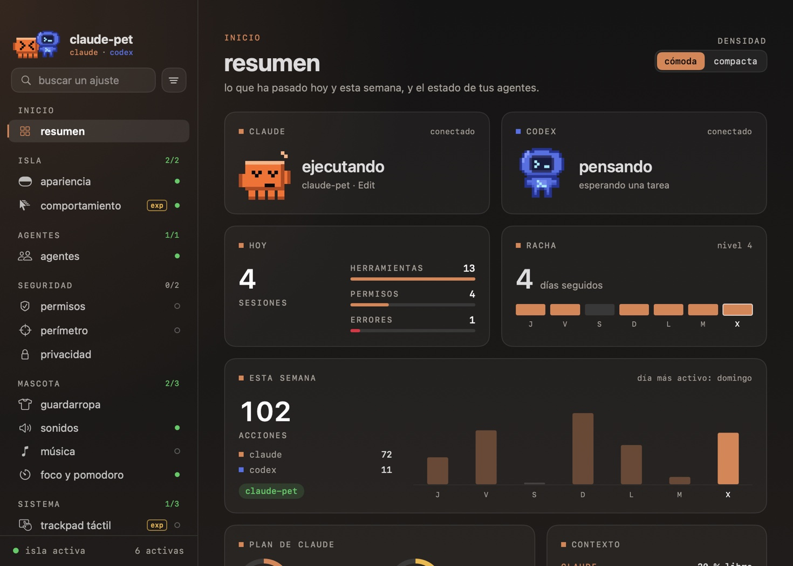

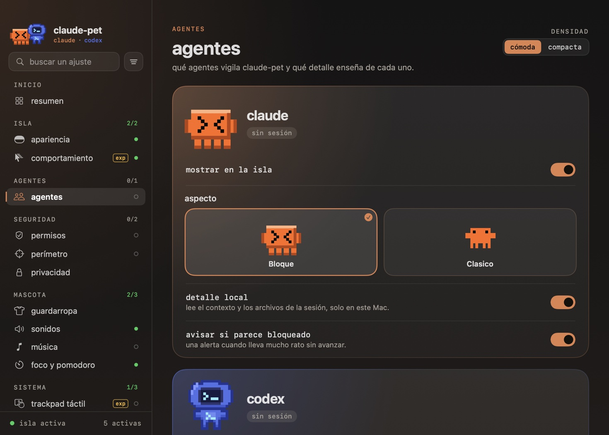

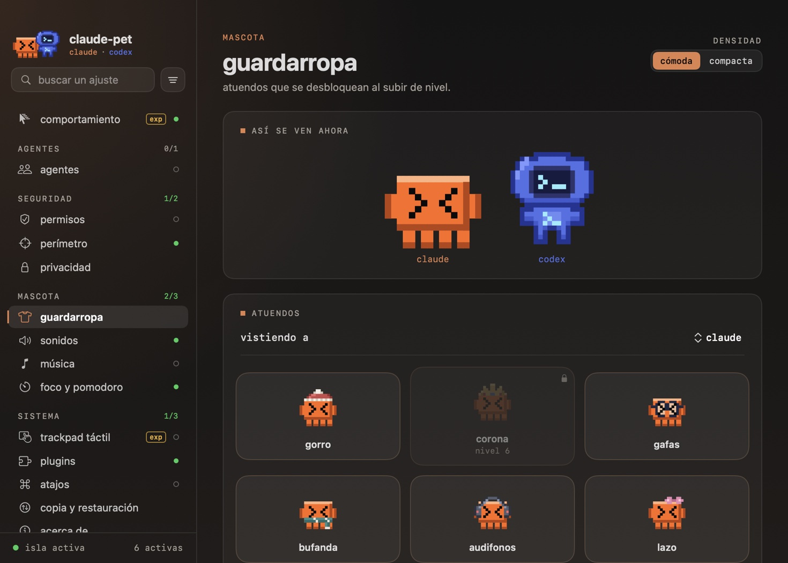

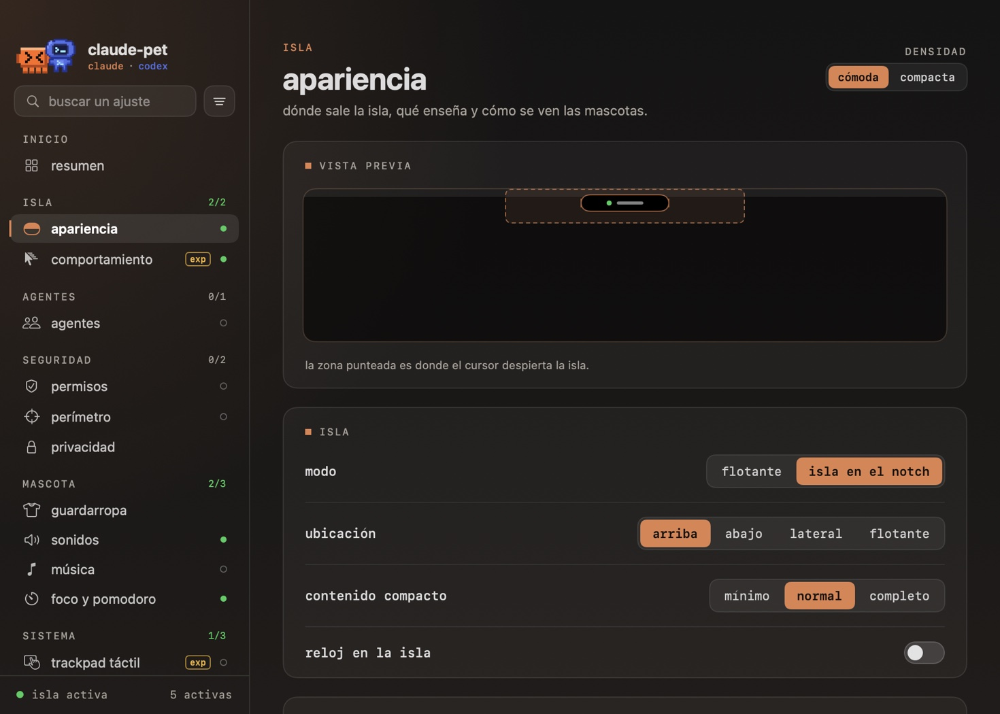

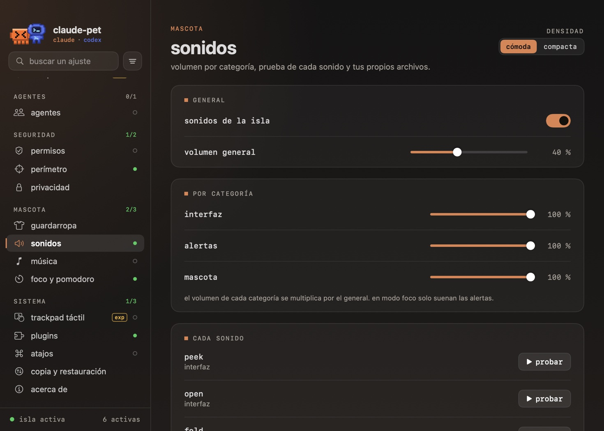

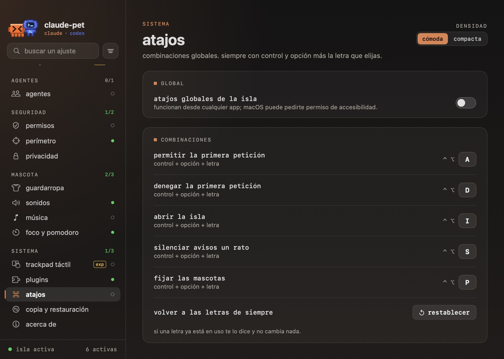

## densidad y accesibilidad

- **densidad**: cómoda o compacta, arriba a la derecha de cada página (`settingsDensity` en UserDefaults, entra en la copia de ajustes). La compacta reduce el relleno de filas, tarjetas y barra lateral.
- **reducir movimiento**: sigue el ajuste del sistema. Las gráficas salen ya dibujadas, los interruptores y selectores cambian sin animar y las mascotas no respiran.
- **contraste alto**: con «aumentar contraste» del sistema las líneas, bordes y textos secundarios suben de opacidad (el estado de un interruptor también se distingue por la posición de la perilla y el de una ficha por la marca ✓). `CLAUDE_PET_HIGH_CONTRAST=1` lo fuerza.
- **CPU en reposo**: las gráficas son `Canvas` que se dibujan una vez y solo crecen (0,45 s) cuando cambian los datos; no hay temporizadores ni animaciones permanentes.

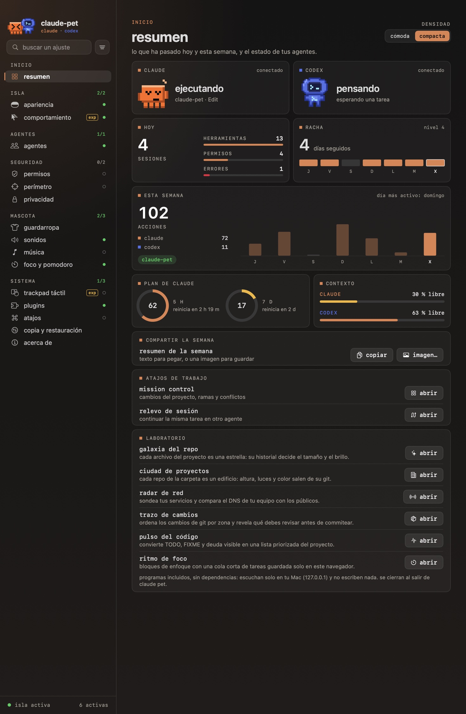

## añadir una página

Dos líneas: un `case` en `SettingsPage` (`SettingsModel.swift`) y una entrada en `SettingsPage.registry` (`SettingsRegistry.swift`) con título, símbolo, grupo, palabras de búsqueda, subtítulo, si es experimental, cómo saber si su función está encendida (`isOn`, opcional) y la vista. Barra lateral, buscador, filtros, contadores y capturas la recogen solos; `--selftest-settings` falla si falta algo.

## mission control

El panel (menú de la barra, dock de la isla o «abrir» en resumen) usa el mismo lenguaje. Arriba, lo único que pide atención ahora; debajo, filtros visibles: buscador de texto, agente, rango (todo, última hora, hoy), estado (todos, activos, esperando, listos, error, con el número de eventos de cada uno), proyecto y orden, más el modo de vista:

- **lista**: hora, agente, estado, proyecto y antigüedad.
- **cuadrícula**: una tarjeta por proyecto con la rama y la salud de su git, sus siete días de actividad en barras, cuántas acciones de cada agente y cuándo fue la última. Pulsar una tarjeta filtra por ese proyecto.
- **línea de tiempo**: la estela de la sesión y una línea vertical de eventos.

Los filtros viven en `MissionFilter` (se prueban con `--selftest-mission-filter`) y se aplican sobre la misma lista que ya guardaba `MissionControl` (16 eventos, solo en memoria). Agente, orden, estado, rango y modo de vista se recuerdan en UserDefaults; el texto y el proyecto no. El git de una tarjeta es el último que se leyó de ese proyecto: si aún no se ha leído, dice «git sin leer». Los estados vacíos distinguen «sin actividad todavía» de «ningún evento coincide» (con botón para quitar filtros). `ClaudePet --snapshot-mission <carpeta>` dibuja las cuatro vistas con datos de ejemplo.

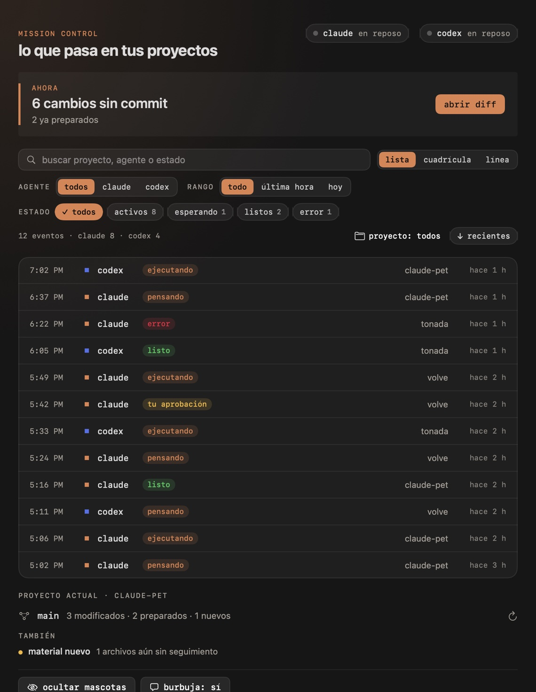

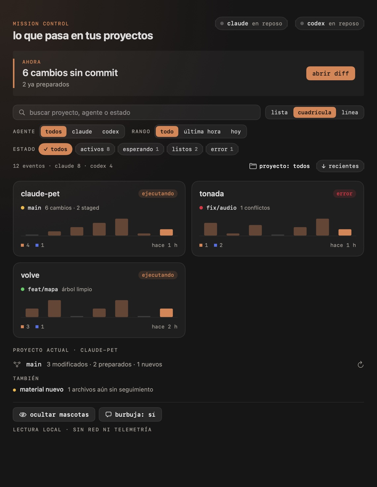

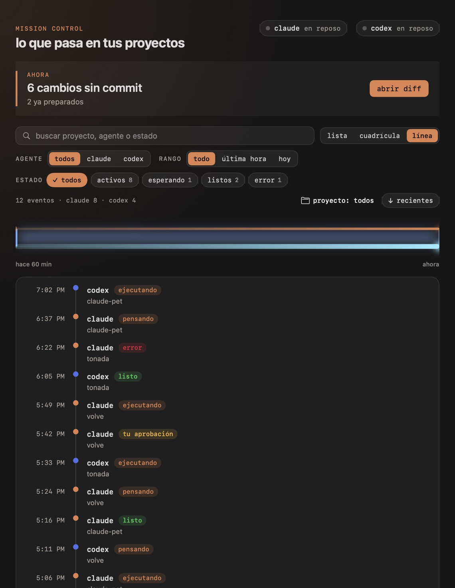

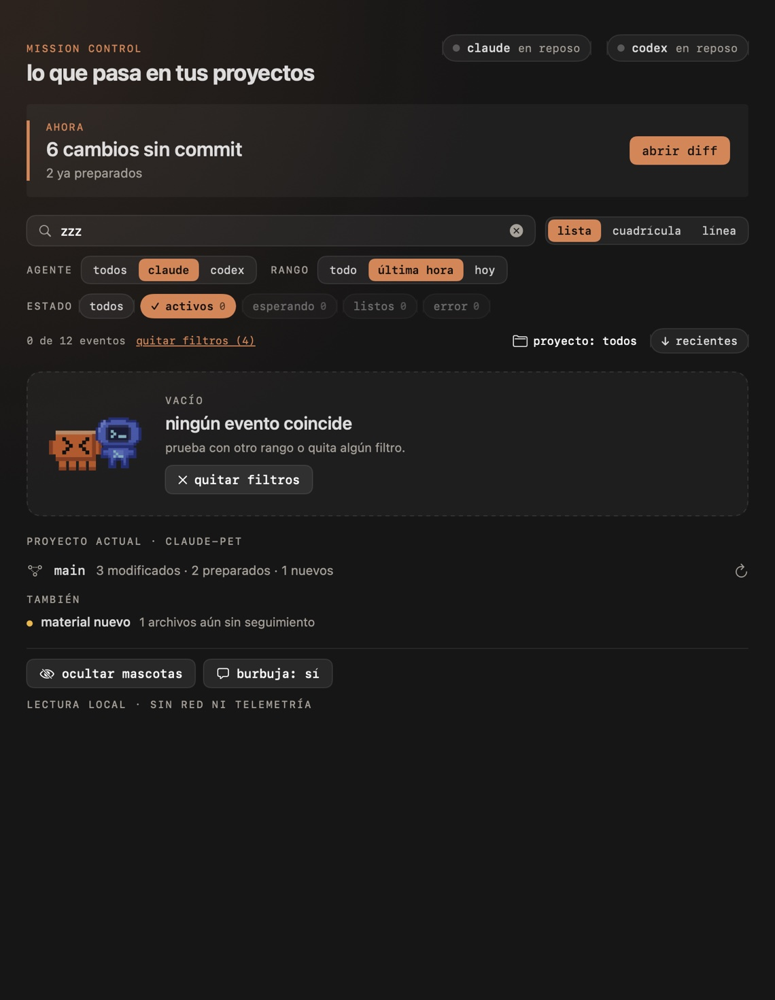

## cosas que conviene saber

- **sonidos por categoría**: el volumen de interfaz, alertas y mascota se multiplica por el general. El motor ya lo soportaba; ahora se guarda y se aplica desde un solo sitio (`PetStore.applySound`), así que isla, menú y ajustes no se desincronizan.
- **atajos**: siempre control y opción más una letra o un número sin acento. Se guardan como `allow=a,deny=d,...` y lo que no se entiende vuelve a su valor original.
- **copia**: el archivo es `{ "format": "claude-pet-settings", "version": 1, "settings": { ... } }`. Al importar solo se aceptan claves conocidas, con el tipo y el rango correctos y hasta 256 KB; el resto se descarta y se cuenta. Los ajustes se leen al arrancar, así que tras importar o restablecer la app ofrece reiniciar.
- **abrir al iniciar sesión**: usa `SMAppService.mainApp` y el interruptor muestra siempre el estado real del sistema, sin guardar nada aparte. Si macOS pide aprobación, la fila lo dice y ofrece abrir Ajustes del Sistema; si el registro falla, enseña el código de error. Con el binario suelto de `.build/debug` (sin paquete .app) queda desactivado con una explicación. Se vuelve a leer al abrir la página y al volver a primer plano, sin temporizador.
- **diagnóstico**: el registro vive en `Diagnostics.swift`, sobre `os.Logger` con el subsystem `local.claudepet.app` y las categorías `app`, `sockets`, `remoto`, `plugins` e `inicio`. Se lee en Consola.app o con `log show --predicate 'subsystem == "local.claudepet.app"' --last 1h`. Solo registra nombres de componentes, códigos de error (dominio y número, nunca el mensaje) y contadores: nunca comandos, rutas, contenido, códigos de emparejamiento ni títulos. El botón «copiar diagnóstico» de acerca de pone en el portapapeles la versión, macOS, modelo, notch, funciones opcionales (sí o no) y el estado de los sockets, sin rutas ni nombre de usuario.
- **capturas**: `ClaudePet --snapshot-settings <carpeta>` genera una imagen por página, más variantes (filtros, compacta, contraste alto). El inicio se dibuja con una semana de ejemplo que solo vive en memoria; `CLAUDE_PET_SNAPSHOT_EMPTY=1` lo desactiva.
- **pruebas**: `ClaudePet --selftest-login` cubre la traducción del estado de `SMAppService` a la interfaz y `--selftest-diag` el registro y el texto del diagnóstico. `ClaudePet --selftest-settings` cubre el registro de páginas, el buscador con sus filtros, la densidad, la tendencia semanal, los medidores del plan, las traducciones y también el buscador, los atajos (duplicados y entradas inválidas), el volumen por categoría y la copia (ida y vuelta, valores hostiles, formato incorrecto, tamaño y restablecer).

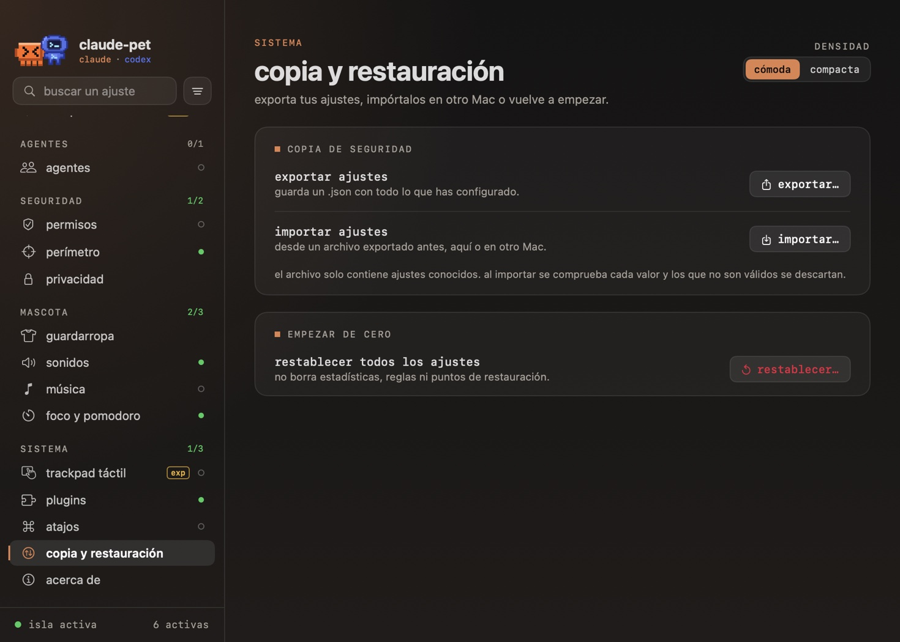
