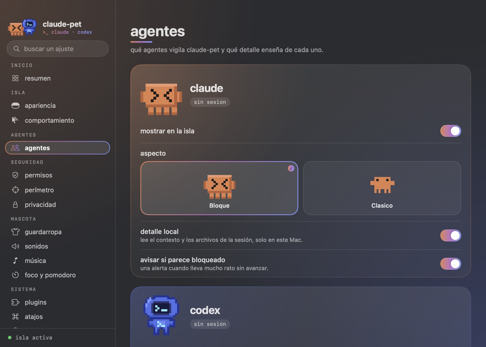
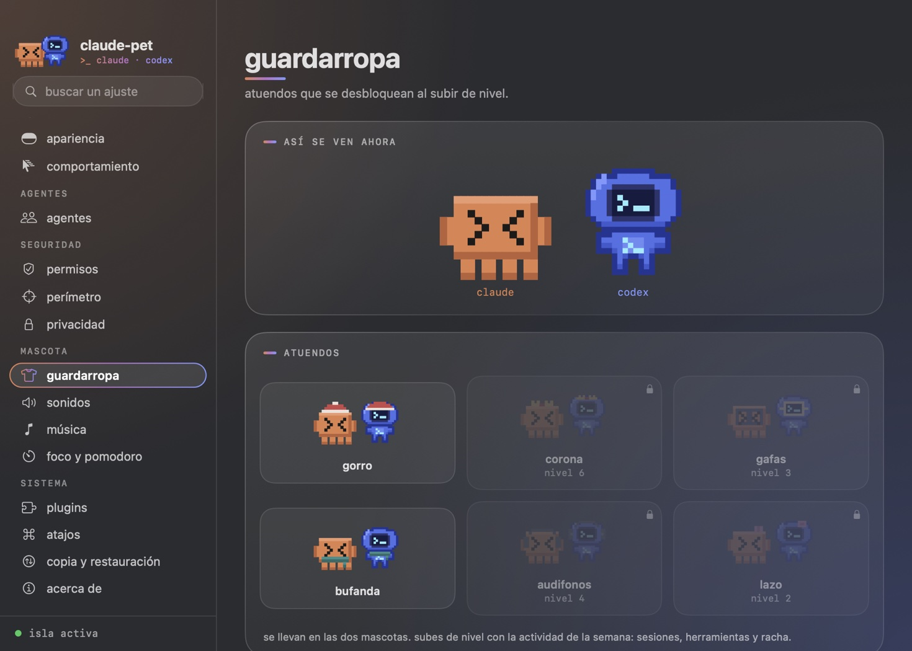
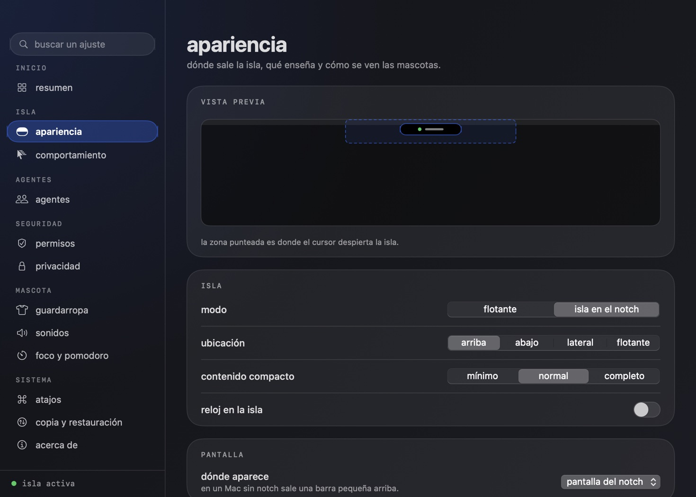
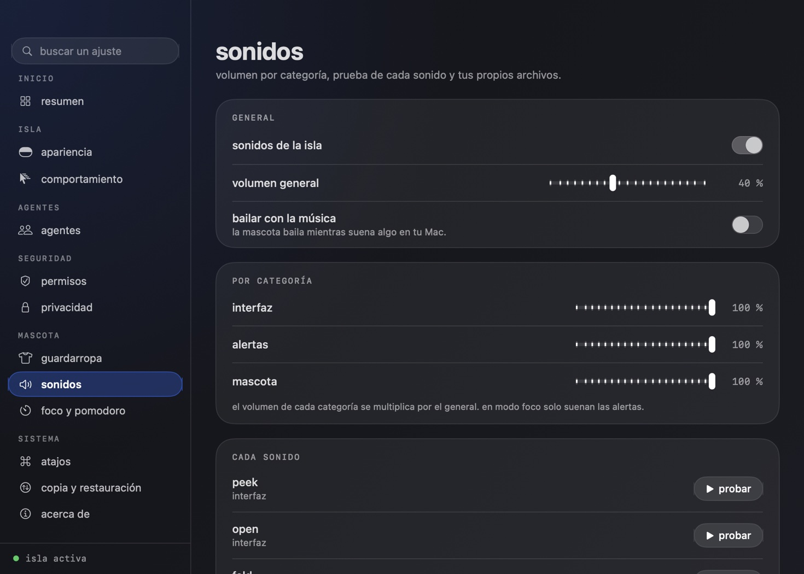
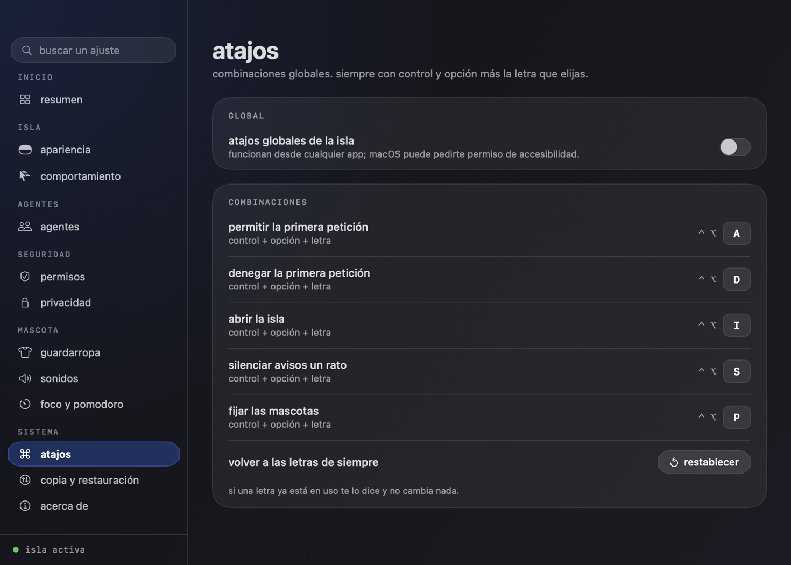
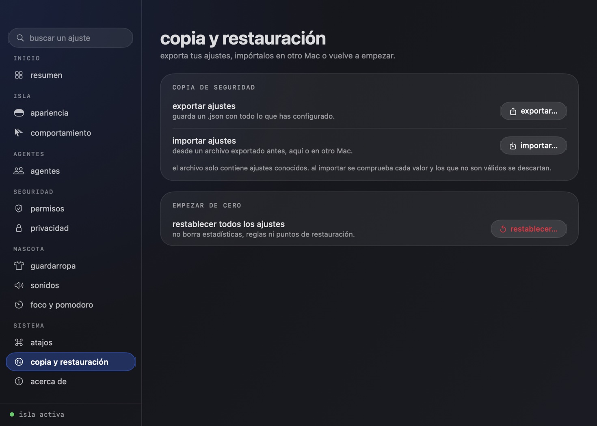

# ajustes

Ventana propia de claude-pet, en el mismo estilo oscuro de cristal que la isla. Se abre desde el menú de la barra ("ajustes…", ⌘,) o con `ClaudePet --open-settings <página>` (`resumen`, `apariencia`, `comportamiento`, `agentes`, `permisos`, `perimetro`, `privacidad`, `guardarropa`, `sonidos`, `musica`, `foco`, `atajos`, `copia`, `acerca`).

La barra lateral agrupa las páginas en inicio, isla, agentes, seguridad, mascota y sistema, y el buscador filtra por título y por palabras clave sin distinguir acentos: escribir "restauracion" lleva a copia y restauración.

## páginas

| página | qué controla |
|---|---|
| resumen | sesiones, herramientas, permisos y errores de hoy; nivel, racha y semana; copiar o guardar como imagen; acceso a mission control y relevo |
| apariencia | modo, ubicación, contenido compacto, reloj, pantalla, mascotas, animaciones, partido, burbuja y avisos visuales, con vista previa |
| comportamiento | ancho y retraso de la zona de activación, cuánto tarda en plegarse, **acceso rápido de la isla** (qué acciones y en qué orden), aparición automática y fijar mascotas |
| agentes | una tarjeta por agente con su estado, mostrar u ocultar, aspecto con previsualización, gestos, detalle local y aviso de bloqueo |
| permisos | responder desde la isla, bloqueo si el proyecto cambia, puntos de restauración y reglas de aprobación (revocar una o todas) |
| perímetro | por dónde puede moverse el agente en cada proyecto: carpetas permitidas, archivos protegidos y avisar o bloquear. ver [PERIMETRO.md](PERIMETRO.md) |
| privacidad | nombre del proyecto al compartir, carpeta de datos, registro de decisiones y borrado de estadísticas |
| guardarropa | vista previa de las dos mascotas, atuendos por nivel con su aspecto en Claude y Codex, y atuendos de temporada |
| sonidos | volumen general y por categoría, prueba de cada sonido y sonidos propios |
| música | reproductor de Spotify y Apple Music en la isla y reacciones de la mascota. ver [MUSICA.md](MUSICA.md) |
| foco y pomodoro | foco manual o por horario y control del pomodoro |
| atajos | letra de cada atajo global, con control de duplicados |
| plugins | instalar, activar con permisos aprobados, ajustes y acciones de cada plugin. ver [PLUGINS.md](PLUGINS.md) |
| copia y restauración | exportar, importar y restablecer ajustes |
| acerca de | versión, commitero y dónde vive cada dato |

## identidad

Claude y Codex comparten la rejilla pixel-art y el glifo `>_`; el color los separa. La ventana usa vidrio real del sistema y el dúo naranja (el bloque de Claude) → violeta → azul (la nube de Codex). Las dos mascotas van en la barra lateral, vestidas como las tengas, y cada agente tiene su tarjeta teñida de su color.

## cosas que conviene saber

- **sonidos por categoría**: el volumen de interfaz, alertas y mascota se multiplica por el general. El motor ya lo soportaba; ahora se guarda y se aplica desde un solo sitio (`PetStore.applySound`), así que isla, menú y ajustes no se desincronizan.
- **atajos**: siempre control y opción más una letra o un número sin acento. Se guardan como `allow=a,deny=d,...` y lo que no se entiende vuelve a su valor original.
- **copia**: el archivo es `{ "format": "claude-pet-settings", "version": 1, "settings": { ... } }`. Al importar solo se aceptan claves conocidas, con el tipo y el rango correctos y hasta 256 KB; el resto se descarta y se cuenta. Los ajustes se leen al arrancar, así que tras importar o restablecer la app ofrece reiniciar.
- **capturas**: `ClaudePet --snapshot-settings <carpeta>` genera una imagen por página.
- **pruebas**: `ClaudePet --selftest-settings` cubre el buscador, los atajos (duplicados y entradas inválidas), el volumen por categoría y la copia (ida y vuelta, valores hostiles, formato incorrecto, tamaño y restablecer).

