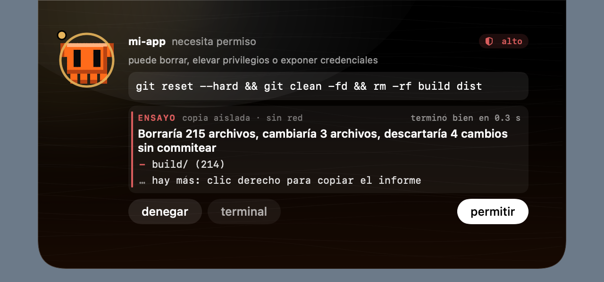

# ensayo

Antes de aprobar un comando, claude pet puede ejecutarlo en una copia del proyecto y decirte qué pasaría. El proyecto real no se toca.

## cómo se usa

- En la isla: cuando el agente pide permiso para un comando de Bash, bajo el comando aparece «ensayar en una copia». El resultado sale en la misma tarjeta y después decides como siempre.
- En la terminal: `ClaudePet --rehearse "rm -rf build && git reset --hard" [carpeta]` imprime el informe completo.

Nada se ensaya solo: hace falta tu clic.

## qué hace

1. Clona el repositorio que contiene la carpeta del permiso con `clonefile` (APFS, copia en escritura: es instantáneo y no ocupa espacio hasta que algo cambia). La copia vive en `~/Library/Caches/claude-pet/ensayo/` y se borra al terminar.
2. Ejecuta el comando dentro de la copia con `sandbox-exec`: sin red (tampoco sockets locales), sin escribir fuera de la copia, sin abrir apps, AppleScript, preferencias ni portapapeles. La carpeta personal y la temporal son de mentira. Las rutas absolutas del proyecto que aparezcan en el comando se cambian por las de la copia.
3. Compara la copia antes y después y lo cuenta en condicional:
   - archivos que borraría, cambiaría o crearía, agrupados por carpeta;
   - en un repositorio, si movería HEAD, cambiaría de rama o descartaría cambios sin commitear;
   - lo que escribiría en tu carpeta personal (por ejemplo `~/.zshrc`);
   - cómo terminó: bien, con qué código de error o cortado a los 20 s.

## límites

- Es un ensayo, no una bóveda: evita accidentes, no detiene a un programa hecho para escapar de la caja de arena.
- Sin red: un comando que depende de internet (`npm install`, `git push`, `curl`, `pip install`...) no llega a hacer su trabajo, así que no se ejecuta: el ensayo avisa al instante («usa la red y el ensayo corre sin ella: no se puede saber qué haría») en lugar de esperar al plazo. Si un comando sin esas palabras intenta salir a la red a mitad, el informe lo marca como incierto en vez de afirmar que no cambiaría nada.
- En la carpeta personal solo se informa de lo que importa (por ejemplo `~/.zshrc`); los registros, cachés e historiales que escribe cualquier herramienta (`~/.npm/_logs`, `~/.cache`, `~/.zsh_history`...) se descartan.
- Solo ve archivos. No ve lo que el comando haría en una base de datos, en un servicio o en otro proceso, porque no le deja llegar a ellos.
- Leer sí puede: el comando lee tu disco como lo haría de verdad. Lo que no puede es sacar nada (no hay red) ni dejar nada fuera de la copia.
- Necesita un disco APFS con el proyecto y la carpeta de caché en el mismo volumen. La carpeta personal entera o el disco no se ensayan; un proyecto de más de 400 000 entradas tampoco.
- El comando y la ruta completa llegan a la app por el segundo mensaje del hook de permisos (ver [ISLAND.md](ISLAND.md)): con un hook instalado antiguo el botón no aparece.

## privacidad

El comando, el informe y la copia viven solo mientras el permiso está pendiente. No se escriben en la auditoría, no cruzan el pet bus, no llegan a los plugins ni a Visto, y no se registran.

## pruebas

`ClaudePet --selftest-rehearsal` comprueba la comparación, el perfil y el texto, y luego ensaya de verdad sobre un proyecto temporal: borrados, rutas absolutas, escritura fuera, carpeta personal, plazo, código de salida, apps bloqueadas y un `git reset --hard` que descartaría trabajo. `--snapshot-rehearsal <ruta.png>` dibuja el bloque y la isla.
