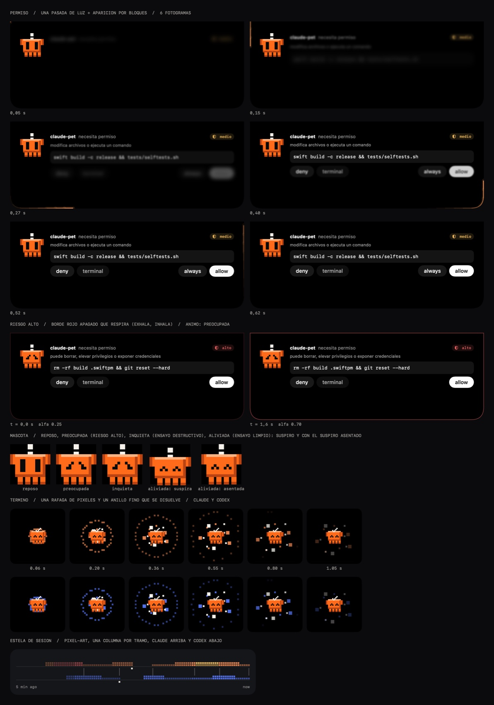

# isla de claude pet

## qué hace

claude pet muestra claude y codex como mascotas pixel-art flotantes o como una isla anclada al notch. la isla puede asomar, compactarse y abrirse para enseñar permisos, preguntas, contexto, cambios de git, actividad, mission control y relevo de sesión.

## instalación

desde el repositorio:

```sh
./install-hooks.sh
```

activa `isla en el notch` en el menú. responder permisos y preguntas desde la isla es opt-in. el instalador es idempotente y las pruebas usan `HOME` temporal; no se debe editar `~/.claude/settings.json` a mano.

las preferencias tipadas de la isla se documentan en [CONFIG.md](CONFIG.md). un archivo inválido conserva la última configuración válida y no bloquea los hooks.

pruebas principales:

```sh
swift build
.build/debug/ClaudePet --selftest-island
.build/debug/ClaudePet --selftest-permission hooks/pet-permission.sh
.build/debug/ClaudePet --selftest-question hooks/pet-question.sh
```

## protocolo local

los hooks usan `~/.claude-pet/ask.sock`, un socket unix 0600 que solo acepta el mismo uid. `pet-permission.sh` envía `perm<TAB>sesión<TAB>herramienta<TAB>proyecto<TAB>siempre<TAB>detalle`; `pet-question.sh` envía `ask<TAB>sesión<TAB>proyecto<TAB>base64(json de questions)`.

### segundo mensaje: el cambio real

`pet-permission.sh` añade al final del detalle un carácter de control (`0x1F`) cuando va a mandar un segundo mensaje por la misma conexión, justo detrás de la línea:

```
diff<TAB>N<LF>
N bytes de json (una sola línea, utf-8)
```

el json lleva `cwd`, `k` (`edit`, `multi`, `write`, `nb`, `bash` o `none`) y, según la herramienta: `p` (ruta), `e` (pares `o`/`n` de Edit y MultiEdit, hasta 20), `c` (contenido de Write o `new_source` de NotebookEdit), `md` (modo de celda) y `cmd` (el `command` de Bash sin recortar ni limpiar, solo si cabe en 32 K caracteres; si no, no se envía). cada texto es `{"t": texto, "m": líneas omitidas}`: el hook lo recorta por caracteres (nunca parte un utf-8) y cuenta lo que dejó fuera. jq escapa tabuladores, saltos y nulos, y la app lee exactamente N bytes (máximo 160 KiB; el hook envía como mucho 128 KiB y reintenta con topes más pequeños si el json se pasa), así que ningún byte del contenido puede cerrar el encuadre ni inyectar campos.

compatibilidad: la marca es un carácter de control y las apps antiguas lo descartan al limpiar el detalle, leen solo hasta el primer salto de línea y vacían el resto de la conexión, así que un hook nuevo con una app vieja se comporta como siempre. un hook antiguo no trae marca y la app nueva no espera nada. si el segundo mensaje falta, llega mal o tarda más de 2 s, el permiso aparece igual, sin cambio.

la app lee el archivo actual de un Write (solo archivos normales de hasta 512 KiB, sin bloquearse con FIFO) y calcula el diff por líneas (Myers, con contexto de dos líneas, hasta 160 líneas dibujadas y «y N líneas más»), todo en la cola del socket y nunca en el hilo principal. `PermissionAsk.change`, `rawCommand` y `cwd` viven solo en memoria mientras el permiso está pendiente: no se escriben a disco, no entran en la auditoría ni en los eventos para plugins, no pasan por el pet bus ni por `Diag`, y Visto sigue recibiendo solo lo de antes. `--snapshot-permission-diff <ruta.png>` dibuja la tarjeta con cambios inventados.

las líneas tienen límite de 4096 bytes y deben terminar en salto de línea. hay un máximo de ocho pendientes por tipo. cualquier entrada inválida, socket ausente, hook muerto o plazo agotado produce salida vacía: claude code continúa en la terminal.

las respuestas de preguntas se validan como json antes de envolverse en `updatedInput`; las decisiones de permisos solo pueden ser `allow`, `always` o `deny`. no se ejecuta shell con rutas, nombres o detalles recibidos del hook.

las tarjetas de permiso muestran un riesgo calculado localmente: lectura como bajo, edición o ejecución como medio y borrado, privilegios, rutas externas o posibles secretos como alto. el clasificador no decide por el usuario ni cambia el fallo abierto del hook.

## rendimiento y seguridad

la isla usa 30 hz mientras está activa y 1 hz cuando está oculta, sin tareas ni atención pendiente. `--selftest-polling` verifica la política.

las transiciones usan un resorte compartido (respuesta 0,46 s, amortiguación 0,9, rebase menor del 1 %, duración máxima 0,72 s); con reducir movimiento se usa un fundido de 0,12 s.

en pantallas sin notch la barra de reposo usa la altura real de la barra de menús en puntos, inyectada desde `NSStatusBar.system.thickness`; las pruebas cubren barras de 24 y 30 puntos.

medición local con `tests/cpu.sh` (30 s, `ps`, después del arranque):

- debug oculto: 4.24 %
- release oculto: 4.42 %
- debug compacto con demo de tareas: 28.50 %; supera el objetivo de 10 % y queda pendiente optimizar el lienzo animado de la mascota.

`sample` confirmó que el reposo alto venía de dos fuentes: las `TimelineView` de las ventanas flotantes seguían renderizando aunque estuvieran ordenadas fuera, y `MenuBarExtra` actualizaba el replicante de `NSStatusItem` durante el modo de medición. ambas rutas se detienen en modo oculto. el compacto sigue dominado por `CanvasDisplayList.updateValue` de `PetFace` a causa de la animación activa.

los atajos globales son opt-in, aceptan únicamente ctrl+option+a/d/i/s/p, ignoran repeticiones y se desregistran al cerrar. requieren permiso de accesibilidad de macos.

## sin notch

las macs sin notch (macbook pro m1 2020, macbook air, imac, mac mini, monitores externos) usan una pastilla propia en vez del recorte del notch. decisiones de geometría, todas en `NotchGeometry` y cubiertas por `--selftest-placement` (matriz de 7 pantallas sintéticas por 4 ubicaciones por 4 modos):

- **altura**: la de la barra de menús real de esa pantalla (`NSStatusBar.system.thickness`), no un valor fijo.
- **ancho**: depende del contenido (`mínimo`, `normal`, `completo`, más reloj opcional) y se acota al espacio central libre de la barra; los items reales de la barra no se pueden leer de forma pública, así que se usa un margen conservador.
- **forma**: fondo negro, borde interior de 0,5 pt, sombra solo hacia dentro de la pantalla y esquinas redondeadas según el borde del que sale. con alto contraste el borde sube a 1 pt.
- **zona de activación**: franja centrada de 120 a 400 pt (por defecto 240) con retraso configurable (por defecto 0,15 s). con la barra de menús oculta se reduce a una línea de 4 pt en el borde, para no robar clics a las apps.
- **ubicaciones**: arriba, abajo (encima del dock), lateral (borde derecho, centrada) y flotante (separada 8 pt, con desplazamiento recordado).
- **pantallas**: `pantalla del notch`, `seguir al ratón` (salta tras 0,6 s seguidos en la otra pantalla) y `pantalla fija` por nombre.
- **espacios**: se muestra en todos los escritorios y sobre apps a pantalla completa solo con hover en el borde o con alerta.

capturas por entorno y escala (1x y 2x) en `docs/img/sin-notch/`; se regeneran con `tests/snapshots-sin-notch.sh`.

## límites conocidos

### sin notch

en pantallas sin notch la isla usa una pastilla centrada con la altura real de la barra en puntos. el ancho compacto puede limitarse por márgenes centrales conservadores para no tapar el reloj ni los iconos. `ScreenMetrics` permite probar barras llenas y resoluciones mixtas sin depender de una pantalla conectada.

para regenerar las capturas sintéticas:

```sh
tests/snapshots-sin-notch.sh
```

- no se ha verificado sobre el notch físico ni el clic atravesante en una pantalla real.
- no se ha verificado el foco real de terminal, finder o mission control.
- no se ha verificado voiceover real ni el permiso de accesibilidad.
- falta validar el ciclo completo con una sesión real de claude code y codex.
- las capturas son snapshots de `ImageRenderer`, no sustituyen una ejecución en pantalla real.

## checklist manual

- [ ] notch real: activa `isla en el notch`, mueve el cursor sobre el notch y confirma que asoma y se abre centrada, sin tapar la barra de menús.
- [ ] clic traversante: con la isla oculta, haz clic fuera de su forma y confirma que la app bajo ella recibe el clic; repite dentro y confirma que abre el detalle.
- [ ] permiso real: activa `responder permisos desde la isla`, ejecuta una herramienta que pida permiso y pulsa `permitir` y después `denegar`; claude code debe recibir cada decisión.
- [ ] pregunta real: ejecuta una llamada a `AskUserQuestion`, responde una opción desde la tarjeta y confirma que la sesión continúa con esa respuesta.
- [ ] voiceover: activa voiceover, enfoca la isla y confirma que anuncia agente, estado, porcentaje y alerta sin leer comandos completos.

el detalle de capacidades y cambios pequeños está en [CHANGELOG-ISLAND.md](CHANGELOG-ISLAND.md).

las decisiones de permisos se guardan localmente en `~/.claude-pet/audit/decisions.jsonl`, con permisos 0600, solo durante 90 días y sin comandos ni rutas completas. se puede cambiar la carpeta en pruebas con `CLAUDE_PET_AUDIT`.

el menú permite abrir ese registro directamente; si todavía no existe, crea un archivo vacío con permisos privados.

## checklist para macbook pro m1 2020 (sin notch)

- [ ] barra clara: mueve el cursor al centro de la barra de menús; la pastilla asoma y no tapa iconos ni el reloj.
- [ ] barra oscura (fondo de pantalla oscuro): el borde fino se ve y la silueta no se funde con la barra.
- [ ] autoocultar la barra de menús (ajustes del sistema, escritorio y dock): al llevar el cursor al borde superior la isla asoma sin dejar hueco.
- [ ] app a pantalla completa: la isla no aparece sola; con el cursor en el borde asoma, y con un permiso pendiente abre.
- [ ] monitor externo: elige `pantalla fija` y luego `seguir al ratón`; al cruzar de pantalla espera cerca de 0,6 s antes de saltar.
- [ ] dos espacios: cambia de escritorio con ctrl+flecha; la isla sigue ahí.
- [ ] ubicación `abajo`: queda encima del dock, nunca detrás.
- [ ] clics: con la isla oculta, haz clic en un menú de la barra justo debajo; debe abrirse el menú.
- [ ] sonido: prueba "probar sonido de terminado" en el menú y confirma volumen razonable.
- [ ] guardarropa: clic derecho sobre la mascota; elige gafas y gorro y confirma que los ojos siguen viéndose.

## isla viva: efectos de entrada

pocos efectos, todos en eventos y todos con una función pura detrás (`IslandCinema.swift`, probada con `--selftest-cinema`). en reposo la isla no redibuja: no hay `TimelineView` permanente; los efectos animan un solo dato (la edad) con el motor de SwiftUI durante unos segundos y se quitan solos.

- **permiso: barrido de luz.** una pasada de 0,6 s por el borde izquierdo, el fondo y el derecho (el de arriba queda pegado a la pantalla), en el color del agente teñido por el riesgo (`IslandCinema.accent`: nada en bajo, un toque ámbar en medio, rojo apagado en alto).
- **permiso: aparición por bloques.** cabecera, aviso, comando o cambio, ensayo y botones entran con 55 ms de desfase, suben 8 pt y el desenfoque (7 pt) se afila. no mueven nada del diseño, así que `PetStore.permissionCardHeight` no cambia.
- **riesgo alto.** el borde respira en `#D85C5C` entre 0,25 y 0,7 de opacidad, 4 ciclos de 3,2 s, y se queda fijo; sin parpadeos.
- **mascota.** con riesgo alto y sin ensayo, ojos preocupados; con un ensayo destructivo, además tiembla; con uno limpio suspira y pone ojos contentos (sin corazones). el ensayo manda sobre el riesgo (`IslandCinema.mood`).
- **terminó.** una ráfaga de 14 píxeles y un anillo fino de puntos que se disuelve (1,2 s), en la rejilla de 32 celdas y dibujado con `FxCanvas`. si hay avance de cambios, espera a que acabe.
- **muelle.** respuesta 0,46 s y amortiguación 0,9 (sin rebote apreciable); la línea de contexto se desliza con amortiguación crítica.
- **micro.** luz que sigue al cursor dentro de los botones y cifras que ruedan en la cola de permisos (macOS 14 o superior).
- **estela de sesión.** pixel-art: una columna por tramo, la altura es lo que hizo el agente (pensar una celda, herramienta dos, esperar hueca, error rojo), claude `#E0824F` arriba y codex `#5270E8` abajo; corchetes finos donde trabajan a la vez.

con animaciones apagadas, reducir movimiento o ahorro de energía no hay barrido, escalonado ni respiración: la tarjeta aparece con un cambio de opacidad, el riesgo alto se marca con un borde fijo y el animo de la mascota se ve igual pero sin temblor ni suspiro. con contraste alto no hay luz en los botones.

`--snapshot-cinema <ruta.png>` dibuja la hoja de contacto de los efectos (seis fotogramas de la entrada, el borde de riesgo, los ánimos, el cierre y la estela):



