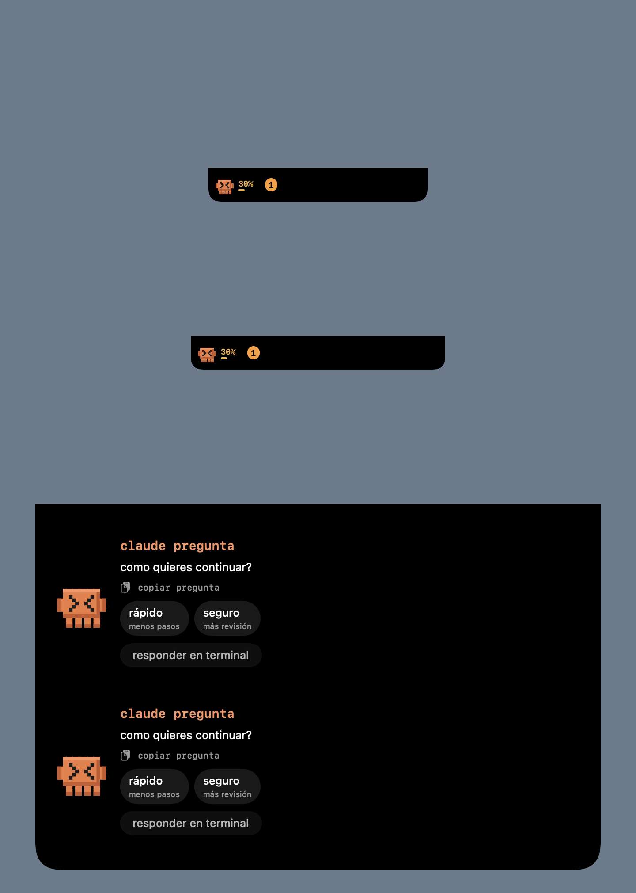
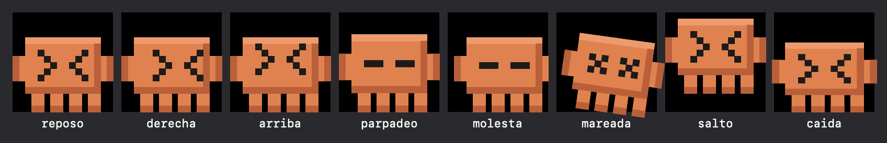

# isla de claude pet

plan para que claude pet viva en el notch (o en la barra superior en pantallas sin notch) y se comporte como un compañero integrado, al estilo de coucou. se reimplementa con las mascotas pixel-art de claude y codex; no se copia código ni assets de coucou.

## que ya existe y se reutiliza

| pieza de claude pet | papel en la isla |
| --- | --- |
| estados de `PetState` y burbuja de tarea | línea de actividad de la vista abierta |
| aro de contexto (`ContextMeter`) | indicador en la mascota compacta y en la vista abierta |
| mapa de archivos y diff (`FileOrbitView`, `GitPulse`) | tarjeta de diff con `+N −M` |
| mission control y relevo de sesión | pestañas de la vista abierta |
| claudwler y web scout | acciones desde la vista abierta |
| pet bus y `EventServer` | canal de eventos de las dos mascotas |

## que falta frente a coucou

1. isla anclada al notch con cuatro modos: oculta, asoma, compacta y abierta. **hecho: `IslandMachine`** (reglas, tiempos y autoprueba `--selftest-island`).
2. ventana sin bordes que se coloca en el notch real, o en una barra de 80 pt si no hay notch, con clics traversantes fuera de la forma. **hecho: `NotchGeometry` e `IslandController`**; el menú tiene el selector `modo` (flotante o isla en el notch) y la pantalla se recalcula al conectar o desconectar monitores.
3. aprobar o denegar permisos desde la mascota. **hecho: `PermissionServer` y `hooks/pet-permission.sh`** (ver abajo). es opt-in.
4. responder preguntas de `AskUserQuestion` desde la isla. **hecho: `pet-question.sh`, `QuestionServer` y tarjeta de opciones** (incluye preguntas de selección única; la selección múltiple queda representada en el protocolo y sigue pendiente en la tarjeta).
5. animación de personaje: respiración, parpadeo, ojos que siguen el cursor, reacción al toque (molestia y mareo), salto al terminar. **hecho: `PetAnimator`** (falta el saludo al asomar). con movimiento reducido solo queda la mirada.
6. pestaña por agente (claude y codex) con su línea de pasos recientes. **hecho: selector claude/codex**; codex solo muestra el estado y la línea que ya publica su adaptador.
7. aro de contexto y mapa de archivos dentro de la isla. **hecho: reutiliza `ContextRingView` y `FileOrbitView`** con los mismos estados normal, caution y critical.
8. mission control y relevo de sesión accesibles desde la isla. **hecho: botones directos en la vista abierta**.
9. limpieza al recibir `SIGTERM` o `SIGINT`. **hecho: detiene sockets y borra la bandera opt-in**.
7. saltar a la terminal de la sesión.
8. vestuario y sonidos propios.

## orden de trabajo

1. máquina de estados de la isla (hecho).
2. ventana de la isla y geometría del notch, sin cambiar las mascotas flotantes: ajuste en el menú para elegir entre flotante e isla (hecho).
3. animación de personaje en la isla (hecho).
4. permisos bloqueantes con protocolo del socket documentado y prueba de que, si la app no responde, claude code sigue con su flujo normal (hecho).
5. preguntas y saltar a la terminal. **parcial: `TerminalTargetResolver`**.
6. vistas de contexto, diff, mission control y relevo dentro de la isla.

## permisos desde la isla

activación (todo opt-in):

1. `./install-hooks.sh` copia `pet-permission.sh` y añade un segundo hook de `PermissionRequest` con plazo de 120 s. pide confirmación antes de tocar `~/.claude/settings.json`.
2. en el menú, modo `isla en el notch` y el interruptor `responder permisos desde la isla`.

entonces, cuando claude code pide un permiso, la isla se abre sola con la herramienta, el proyecto y el comando o archivo, y tres botones: denegar, siempre (solo si claude code sugirió una regla) y permitir. si hay varios, se responden en orden de llegada.

protocolo: el hook abre `~/.claude-pet/ask.sock`, envía una línea `perm<TAB>sesión<TAB>herramienta<TAB>proyecto<TAB>siempre<TAB>detalle` y espera una línea `allow`, `always` o `deny`. la app mantiene la conexión abierta; si el hook muere (por ejemplo porque respondiste en la terminal) la conexión se cierra y la tarjeta desaparece. el hook imprime la decisión en el formato de `PermissionRequest` de claude code.

el comando que se va a aprobar se muestra en la isla; viaja solo por el socket local y no se guarda ni se publica en el pet bus.

## reglas de seguridad para los permisos

- el hook no hace nada si falta la bandera `~/.claude-pet/island-permissions` (la app la crea solo en modo isla con el interruptor y la borra al salir), el socket, `jq` o `perl`; si se agota el plazo o la app se cierra, no devuelve decisión y claude code pregunta en la terminal como siempre.
- un máximo de 8 permisos pendientes; el noveno se rechaza y se pregunta en la terminal.
- el socket es 0600 y solo acepta conexiones del mismo usuario; cada permiso se responde una sola vez.
- «siempre permitir» solo se ofrece cuando claude code envía sugerencias de permiso.

## modos

de arriba abajo: oculta (invisible, es el propio notch), asoma, compacta y abierta. la imagen sale de `ClaudePet --snapshot-island <ruta.png>`; en uso real la isla se anima con un resorte al cambiar de modo.

## limites actuales

- la isla muestra a claude y un codex pixel-art animado por estado; claude saluda durante 1,4 s al asomar. con reducir movimiento no se animan ni codex ni el saludo.
- `AskUserQuestion` ya llega por `ask.sock` y se puede responder desde la tarjeta; selección múltiple, varias preguntas visibles a la vez y verificación con una sesión real de Claude Code quedan pendientes.
- el salto a terminal solo se activa cuando hay una única ventana visible de terminal, iterm, ghostty, warp o vs code cuyo título contiene el proyecto; con ambigüedad muestra `terminal no identificada` y no enfoca nada.
- la vista abierta conserva hasta ocho pasos recientes de claude en memoria; muestra herramienta, objetivo recortado y `+N -M` cuando el objetivo coincide con un archivo cambiado. pulsar un paso reutiliza `GitPulse`/`DiffPullReader`; no se escriben comandos ni rutas completas.
- verificado: el protocolo de permisos de extremo a extremo (`--selftest-permission`), las reglas y la geometría con `--selftest-island` y el dibujo de los cuatro modos con la imagen anterior. no se comprobó en una pantalla real el paso por encima del notch ni los clics traversantes; hay que probarlo con `ClaudePet -layout island`.

## animación del personaje

de izquierda a derecha: reposo, mirando a la derecha, mirando arriba, parpadeo, molesta (un toque), mareada (tres toques en 2 s), salto al terminar y caída. imagen generada con `ClaudePet --snapshot-poses <ruta.png>`.

- respiración: el cuerpo se estira un 4 % desde los pies cada 4 s.
- parpadeo: cada 2 a 5 s, con un parpadeo doble ocasional.
- mirada: las pupilas se desplazan una celda hacia el cursor.
- un toque sacude y entrecierra los ojos; tres seguidos marean 1,8 s.
- al terminar una tarea salta 3 celdas y cae con un pequeño aplastamiento.
- con «reducir movimiento» o con animaciones apagadas solo queda la mirada.

## preguntas desde la isla

el hook `hooks/pet-question.sh` solo actúa para `PreToolUse` con `tool_name=AskUserQuestion`, exige la bandera opt-in y envía `ask<TAB>sesión<TAB>proyecto<TAB>base64(json de questions)` por el mismo socket local. la tarjeta muestra la primera pregunta y sus opciones. la respuesta vuelve como `updatedInput.answers`; si falla el socket, falta una herramienta o vence el plazo, el hook sale sin imprimir y claude code conserva su flujo normal en la terminal.

formato verificado contra la documentación oficial de hooks de claude code: [hooks reference](https://code.claude.com/docs/en/hooks), sección `AskUserQuestion`. `PreToolUse` debe devolver `hookSpecificOutput.permissionDecision = "allow"` y `updatedInput` con las `questions` originales más `answers` como objeto que asigna el texto de cada pregunta a su respuesta; en selección múltiple las etiquetas se unen con comas.

prueba automática: `ClaudePet --selftest-question hooks/pet-question.sh` ejecuta el hook real con home temporal y cubre opción única, múltiple, cuatro preguntas, texto libre, muerte del hook, app cerrada, plazo, entradas inválidas, recorte, controles y límite de pendientes. falta probar el ciclo completo con una sesión real de claude code.

prueba automática adicional: `ClaudePet --selftest-terminal` cubre coincidencia única, ambigüedad y aplicación no terminal. no se probó el foco de una ventana real.
