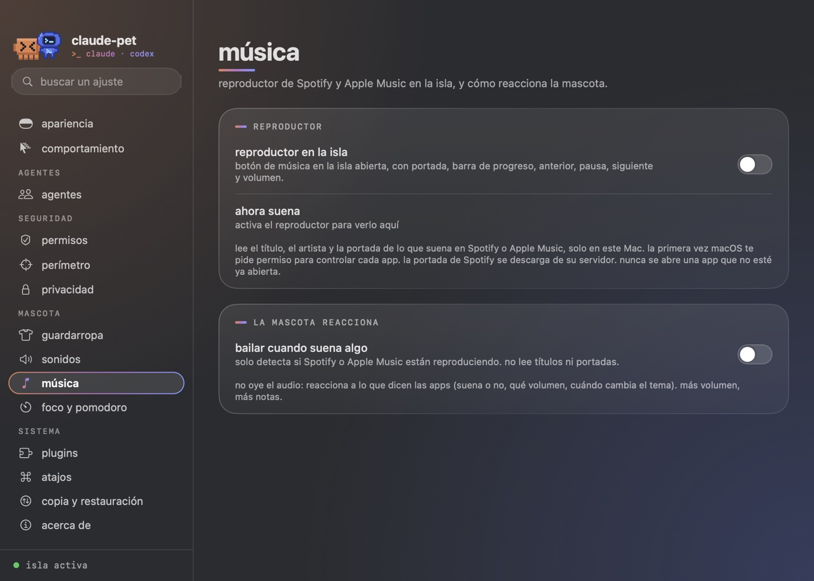

# música

Un reproductor de Spotify y Apple Music en la isla, y una mascota que reacciona a lo que suena.

Se activa en Ajustes → música. En la isla abierta aparece un botón de nota junto al selector de agente; al pulsarlo, el panel de actividad deja paso al reproductor: portada, título y artista, barra de progreso que se arrastra para saltar, anterior, pausa, siguiente y volumen. También hay un submenú de música en el menú de la barra.

## portadas

La portada sale de Spotify (su CDN) o de Apple Music (del propio reproductor) y se guarda en `~/Library/Caches/claude-pet/covers` a 192 px, en JPEG, hasta 80 archivos y 24 MB (se borra lo más antiguo). La próxima vez que suene esa canción aparece al instante, sin red. Mientras no hay portada se dibuja una propia: degradado estable por título con su inicial.

En Ajustes → música, **recientes** muestra las últimas canciones con su portada; al pulsar una se vuelve a poner (la app debe estar abierta). El historial vive en `~/.claude-pet/music-index.json` (60 canciones, permisos 0600) y se puede borrar con sus portadas desde el mismo sitio.

## fluidez

Las consultas a Spotify y Music van por AppleScript en una cola propia, de una en una, y cada orden lleva `with timeout of 3 seconds`. Si una app no responde, el script falla a los tres segundos y la interfaz sigue fluida; no se encadenan consultas si la anterior no ha vuelto.

## cómo reacciona la mascota

No oye el audio. Reacciona a lo que dicen las apps, que es lo que se puede saber sin pedir permisos de captura:

- **suena o no**: se pone los auriculares y baila mientras suena; al pausar, se los quita.
- **volumen**: sueltan notas que suben de ella, de dos a seis según el volumen.
- **cambio de tema**: un anillo de destellos.

Sin el reproductor activado queda el modo anterior, "bailar cuando suena algo", que solo pregunta si Spotify o Apple Music están reproduciendo y no lee títulos.

## privacidad

- Lee título, artista, álbum, posición, duración, volumen y portada de la canción actual, por AppleScript y solo en este Mac.
- La primera vez macOS pide permiso para controlar cada app (Ajustes del Sistema → Privacidad → Automatización).
- Nunca abre una app: solo pregunta a la que ya está abierta.
- La portada de Spotify se descarga de su CDN (`scdn.co`, solo por https y hasta 3 MB). La de Apple Music se lee del propio reproductor.
- Los scripts son texto fijo; lo único que se interpola son números acotados (posición y volumen).

## pruebas

`ClaudePet --selftest-music` cubre el parseo de ambas apps (comas decimales, milisegundos de Spotify, estado parado, datos corruptos, texto largo o con controles), la lista blanca de portadas, los comandos, la escala de notas y **compila los scripts contra el diccionario real de cada app instalada**. Esa última prueba existe porque una variable llamada `st` no compilaba en Music.
