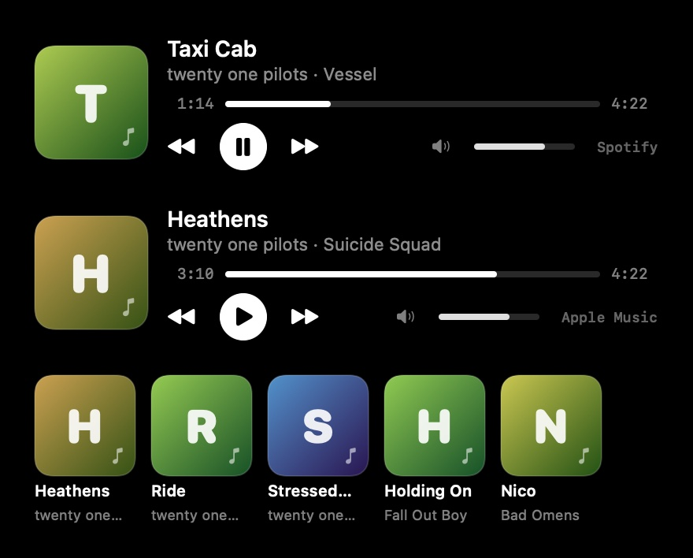
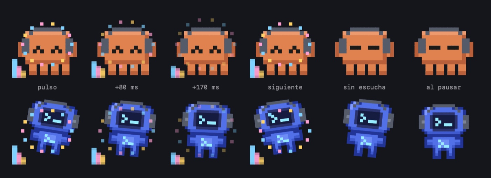

# música

Un reproductor de Spotify y Apple Music en la isla, y una mascota que reacciona a lo que suena.

Se activa en Ajustes → música. En la isla abierta aparece un botón de nota junto al selector de agente; al pulsarlo, el panel de actividad deja paso al reproductor: portada, título y artista, barra de progreso que se arrastra para saltar, anterior, pausa, siguiente y volumen. También hay un submenú de música en el menú de la barra.

## portadas

La portada sale de Spotify (su CDN) o de Apple Music (del propio reproductor) y se guarda en `~/Library/Caches/claude-pet/covers` a 192 px, en JPEG, hasta 80 archivos y 24 MB (se borra lo más antiguo). La próxima vez que suene esa canción aparece al instante, sin red. Mientras no hay portada se dibuja una propia: degradado estable por título con su inicial.

En Ajustes → música, **recientes** muestra las últimas canciones con su portada (la tira de abajo de la captura de arriba); al pulsar una se vuelve a poner (la app debe estar abierta). El historial vive en `~/.claude-pet/music-index.json` (60 canciones, permisos 0600) y se puede borrar con sus portadas desde el mismo sitio.

## fluidez

Las consultas a Spotify y Music van por AppleScript en una cola propia, de una en una, y cada orden lleva `with timeout of 3 seconds`. Si una app no responde, el script falla a los tres segundos y la interfaz sigue fluida; no se encadenan consultas si la anterior no ha vuelto.

## cómo reacciona la mascota

Claude **y Codex** reaccionan a lo que suena. Hay dos niveles:

**Sin permisos extra** (lo que dicen las apps): se ponen auriculares, saltan al empezar la música, suspiran al pausar, sueltan notas (más volumen, más notas) y hay un destello al cambiar de tema. Bailan a un ritmo fijo, con la fuerza del volumen.

**Siguiendo el ritmo de verdad** (opt-in, Ajustes → música → "seguir el ritmo de verdad"): claude-pet oye el audio del Mac y calcula graves, medios, agudos y los pulsos.

- **salta con el bombo**: más alto cuanto más graves.
- **cabecea al compás**, alternando de lado en cada pulso, y se aplasta un poco al caer.
- **ojos contentos** (`^ ^`) cuando suena fuerte.
- **ecualizador** de tres barras (graves, medios y agudos) a un lado y un **aro** que se abre en cada pulso.
- estima el tempo (BPM) a partir de los pulsos.

*De izquierda a derecha: el pulso, 80 ms y 170 ms después, el pulso siguiente (cabecea hacia el otro lado), sin escucha y al pausar.*

### cómo funciona la escucha

Usa ScreenCaptureKit solo para el audio del sistema (el vídeo se reduce a 2×2 píxeles y se ignora; el audio de claude-pet se excluye). macOS lo llama "grabación de pantalla y audio del sistema", te pide permiso y muestra su indicador en la barra de menú mientras escucha. La captura **solo corre mientras suena algo** y el ajuste está activado; al pausar se apaga.

Un analizador sin FFT separa tres bandas con filtros de un polo (graves bajo 150 Hz, medios bajo 2 kHz, agudos el resto), mide la energía cada 10 ms, normaliza con una referencia común y detecta los pulsos con un umbral adaptativo. El audio no se guarda ni sale del Mac: de él solo quedan unos números.

Límites honestos: el detector sigue el bombo y la percusión fuerte, así que con música sin graves marcados (ambient, voz sola) dará pocos pulsos y la mascota se moverá poco. No distingue géneros ni sigue la melodía.

## privacidad

- Lee título, artista, álbum, posición, duración, volumen y portada de la canción actual, por AppleScript y solo en este Mac.
- La primera vez macOS pide permiso para controlar cada app (Ajustes del Sistema → Privacidad → Automatización).
- Nunca abre una app: solo pregunta a la que ya está abierta.
- La portada de Spotify se descarga de su CDN (`scdn.co`, solo por https y hasta 3 MB). La de Apple Music se lee del propio reproductor.
- Los scripts son texto fijo; lo único que se interpola son números acotados (posición y volumen).

## pruebas

`ClaudePet --selftest-audio` prueba el analizador con señales sintéticas (bombos a 90, 100, 120 y 150 BPM a 44,1 y 48 kHz, una mezcla con hi-hat, caja y colchón armónico, silencio, tono constante, ruido, muestras hostiles), el baile, el mezclador a mono y la caducidad de la escucha. La captura real con permiso de pantalla no se puede probar sin una persona que lo conceda.

`ClaudePet --selftest-music` cubre el parseo de ambas apps (comas decimales, milisegundos de Spotify, estado parado, datos corruptos, texto largo o con controles), la lista blanca de portadas, los comandos, la escala de notas y **compila los scripts contra el diccionario real de cada app instalada**. Esa última prueba existe porque una variable llamada `st` no compilaba en Music.
