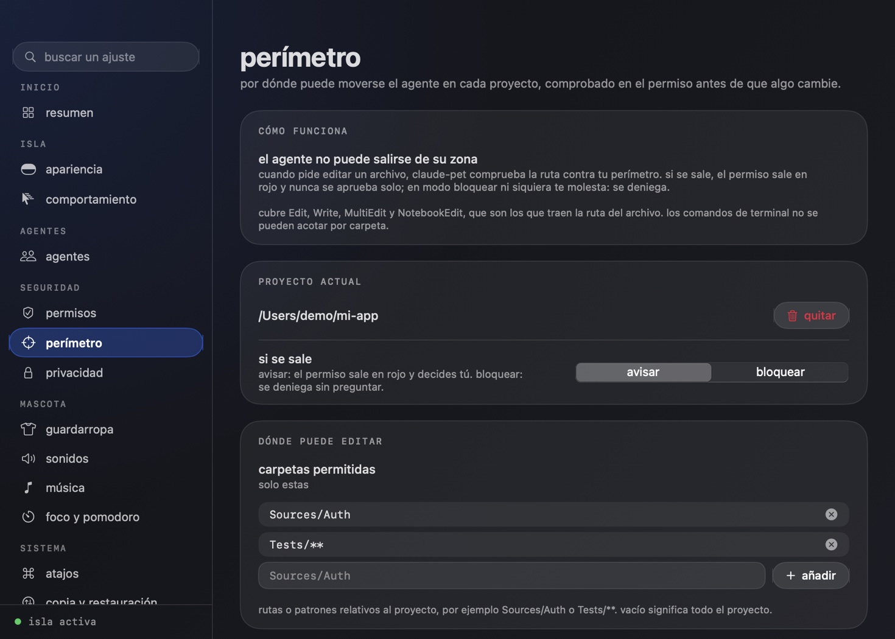

# perímetro

Por dónde puede moverse un agente dentro de un proyecto, comprobado en el permiso y **antes** de que el archivo cambie.

Aprobar permiso a permiso cansa y acaba en un "permitir" automático. Con un perímetro decides una vez la zona y claude-pet vigila el resto: lo que cae dentro pasa por el flujo normal; lo que se sale se marca en rojo, nunca se aprueba solo y, si quieres, se deniega sin molestarte.

La primera tarjeta está dentro de `Sources/Auth`. La segunda se sale de la zona permitida. La tercera toca un archivo protegido (`.env`), que gana sobre la lista de carpetas.

## cómo se define

Ajustes → perímetro, o el menú de la barra → proyecto → "fijar perímetro a este proyecto".

| campo | qué hace |
|---|---|
| carpetas permitidas | rutas o patrones relativos al proyecto (`Sources/Auth`, `Tests/**`). Vacío significa todo el proyecto |
| archivos protegidos | patrones que siempre cuentan como violación. Por defecto: `.env*`, `**/*.pem`, `**/*.key`, `**/id_rsa*`, `.git/**`, `.github/**` |
| si se sale | **avisar**: el permiso sale en rojo y decides tú. **bloquear**: se deniega sin preguntar |

Los patrones son como los de gitignore: `*` no cruza carpetas, `**` sí, `?` es un carácter. Sin barra valen en cualquier carpeta (`.env*` protege `app/.env.local`). No distinguen mayúsculas, como el disco de macOS.

## qué se comprueba y qué no

- **Sí**: Edit, Write, MultiEdit y NotebookEdit, que son los que traen la ruta del archivo en el permiso.
- **No**: los comandos de terminal. Un `Bash` puede escribir donde quiera y no hay una ruta fiable que acotar; el clasificador de riesgo sigue vigilándolos como siempre.
- Las rutas se normalizan antes de compararlas: `Sources/Auth/../Billing/x.swift` cuenta como `Sources/Billing/x.swift`, y un proyecto hermano con el mismo prefijo (`mi-app-otro`) no cuenta como dentro.
- Si hay varios perímetros que cubren un archivo, decide el más específico.

## orden de decisión

1. Si el archivo rompe el perímetro y el modo es **bloquear**, se deniega (queda en el registro de decisiones como "perímetro").
2. Si lo rompe y el modo es **avisar**, una regla de aprobación vigente **no** lo aprueba sola: decide una persona.
3. Si no lo rompe, sigue el flujo de siempre (reglas, riesgo, tarjeta de permiso).

## datos y pruebas

- Se guarda en `~/.claude-pet/perimeters.json` con permisos 0600, hasta 20 perímetros y 30 patrones de 120 caracteres cada lista. Lo inválido se descarta al cargar.
- `ClaudePet --selftest-perimeter` cubre los patrones (20 casos), la evaluación (escapes con `..`, prefijos hermanos, herramientas que no editan, rutas relativas), la validación, el almacén y la puerta de decisión.
- `tests/permission.sh` incluye un caso de extremo a extremo: el hook real pide editar fuera de la zona y la puerta lo deniega sin que nadie responda; dentro de la zona el permiso llega a la isla.
